# 用 WorkBuddy「智水枢01」专家团实测中国六大水电站千年一遇洪水：水深、洪峰流量与二维流速全演进

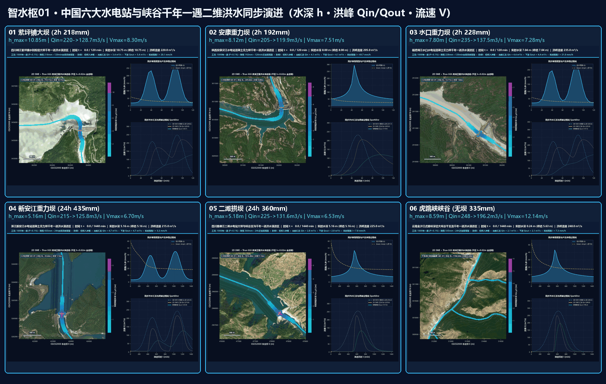

## 场景描述

水工、防汛与设计院工程师在研判千年一遇（`P = 0.1%`）极端洪水风险时，最核心的决策依据永远是三项直观的水动力真算物理量：

1. **淹没水深随时空怎么涨落（`h(x, y, t)` 与最大水深 `h_max`）**：大坝回水壅高后库水位是否漫过防洪堤顶，弯道与分汊深泓淹没包络边界在哪；
2. **洪峰流量经过工程后怎么削峰与错峰（`Q_GB(t)` vs `Qin(t)` vs `Qout(t)`）**：强台风双峰雨型或芝加哥单峰雨型汇流后，不同水电站的滞洪调蓄能把下泄洪峰削减多少（对比天然无坝峡谷）；
3. **二维流速矢量与急流冲击区分布（`V(x, y)`、`Fr` 与 `τ_b`）**：峡谷束窄、弯道凹岸和溢流堰下泄急流段的最大流速与床面切应力集中在哪里，抛石护坦需配多大粒径才不会被冲垮。

过去，拿到这套 **二维全动量浅水方程（2D SWE）动态演进结果**，通常需要动用高价商用流体软件与多专业手工拼接，耗时数周且敏感测绘底图难以上云。本案例演示如何在腾讯 WorkBuddy 中直接召唤已公开上架的 **「智水枢01·流域洪水演进与水工土方专家团」（`oe_5ff32ef82d8963ce`）**，在 **本地零第三方依赖、原始 `DEM / DOM / DXF` 测绘零出域** 前提下，于 `480 × 480` 计算网格叠加 `3 × 3` 真亚网格（**`2,073,600`** 亚网格自由度）上，一次性跑通中国南北方 6 座真实水利枢纽与峡谷的动态水深、洪峰削峰、流速矢量及 22 份全套合规交付。

## 想要完成的任务

- **输入（单工程仅 9 份本地标准文件）**：开源实测 `Copernicus GLO-30` 高程、1m 卫星正射 `DOM`、OSM 实测大坝坝轴线与河网 `DXF/GeoJSON`、`10m` 纵横断面表及 `1000 年一遇` 暴雨过程线，覆盖 **`2h` 短历时强暴雨**（紫坪铺、安康、水口）与 **`24h` 长历时极端暴雨**（新安江、二滩、虎跳峡无坝天然对照）。
- **输出（单工程闭环产出 22 份成果，聚焦三大核心水动力与演进动态）**：
  1. `24 帧` 实时 **2D SWE 水深场 + 暴雨雨型 + 洪峰过程线三联同步演进动图**（`.gif`）与离线交互看板（`.html`）；
  2. 最大淹没水深空间包络图、控制断面洪峰水面线图与 `Q_GB / Qin / Qout` 过程线对比总图；
  3. 二维流速矢量场、床面切应力 `τ_b`、弗劳德数 `Fr` 与深泓线沿程流速剖面图；
  4. 配套 `SL 319` 重力坝/消力池结构蓝图（`A3 PDF` + `PNG`）、`GB 50330` 放坡 `3D DXF`、Excel 清单、Word/PDF 合规报告及 `SHA-256` 验真回执。

## 使用的 Skill

| Skill / 专家团 | 用途 | 来源或安装方式 |
| --- | --- | --- |
| `智水枢01·流域洪水演进与水工土方专家团` | 执行 `2D SWE + True-SGS` 二维水深/流量/流速真算、水工稳定校核与图文全闭环导出 | WorkBuddy 专家中心搜索公开 ID `oe_5ff32ef82d8963ce`（`v2.1.0`）一键启用 |
| `本地文件读写` | 读取工作区实测 `DEM / DOM / DXF / CSV` 并归档 22 份 `./output` 交付件 | WorkBuddy 内置能力 |
| `Python 标准库预检与内业排版` | 零第三方 `pip` 依赖完成 `CGCS2000` 坐标系审计与结果 `SHA-256` 核验 | WorkBuddy 内置 Python 环境 |


## 前置条件

- **WorkBuddy 版本**：Windows / macOS 最新桌面端（已在 WorkBuddy 开放平台公开上架，零服务器配置）
- **本地运行环境**：系统自带 Python 3 标准库（前端零第三方 `pip` 依赖），需基础联网以调用计算网关并接收 `SHA-256` 验真回执
- **数据安全**：原始测绘 `DEM / DOM / DXF` 底图全程驻留本地工作目录，零上传不出域

## 在 WorkBuddy 中的操作

1. **启用公开专家团**：打开 WorkBuddy 左侧边栏 **「专家」**，搜索 `智水枢01` 或公开 ID **`oe_5ff32ef82d8963ce`**（当前版本 `v2.1.0`）加入会话。


2. **打开目标工程目录**：在 WorkBuddy 中挂载对应案例目录（例如 `01_四川岷江紫坪铺水利枢纽大坝千年一遇洪水演进`）。
3. **发送水动力演进指令**：粘贴下方提示词（指明重现期、降雨雨型及 `--has-dam` 有坝 / `--no-dam` 无坝边界）。
4. **验收动图与水动力三联图**：等待计算完成，打开 `./output/` 下的 `03_2D_SWE_洪水演进动画.gif`、`01_2D_SWE_最大水深图_300DPI.png`、`02_2D_SWE_流速矢量与床面切应力图_300DPI.png` 及全套文档。

## 提示词或任务指令

### 1. 通用流域迁移模板（替换占位符即可复用至任意水库/河道工程）

```text
请以当前目录实测 DEM、1m DOM 与河网/结构 DXF 作为输入，调用智水枢01（oe_5ff32ef82d8963ce）开展「<工程项目名称>」<重现期，如 1000年一遇 P=0.1%>（<历时与雨型>，降雨 <雨量> mm，<--has-dam 或 --no-dam>）二维全动量洪水演进、HGL 水面线与水工稳定性校核，将全部 300-DPI 图集、洪水演进 GIF、动态 HTML 与工程论证报告输出至 ./output。
```

### 2. 本案实战指令（以「01 紫坪铺水利枢纽大坝」为例）

```text
请以当前目录实测 Copernicus GLO-30 DEM、Esri 1m DOM 与 OSM 真实大坝/河网 DXF 作为输入，调用智水枢01（hydrotwin-01-flood-hydraulics-earthwork）开展「四川岷江紫坪铺水利枢纽大坝千年一遇洪水演进区」1000年一遇（P=0.1%，120min 台风双峰雨型，降雨 218.0mm，--has-dam 启闭大坝重力稳定校核）二维全动量洪水演进、HGL水面线与水工稳定性校核，将全部 300-DPI 图集、动态 HTML 与工程论证报告输出至 ./output。
```

### 3. 有坝削峰 vs 无坝天然过流对照指令（反事实消融验证）

```text
基于本目录 CGCS2000 实测地形与河道断面，请调用智水枢01运行 1000年一遇（120min 台风双峰雨型，暴雨量 218.0mm）下 `--has-dam`（大坝回水调蓄与 SL 319 稳定）与 `--no-dam`（无坝天然过流）的水深、洪峰流量削峰率与二维流速场对比。
```

## 在 WorkBuddy 中的效果

### 1. 六大枢纽核心水动力实测总表（淹没水深 · 洪峰削峰 · 峰值流速）

六座工程全部采用二阶良平衡 `Audusse SSP-RK2 MUSCL-HLL + True-SGS (3×3)` 全动量二维求解内核，单工程 `480 × 480` 网格（`2,073,600` 亚网格自由度）实算结果如下：

| 序号 | 真实水利枢纽 / 峡谷 | 工况与雨型 | 最大水深 `h_max` (`m`) | 洪峰水位 (`EL m`) | 推理公式 `Q_GB` (`m³/s`) | 2D SWE 汇流洪峰 `Qin` → 下泄 `Qout` (`m³/s`) | 洪峰削峰/坦化率 | 峰值流速 `Vmax` (`m/s`) | 最大 `Fr` / 床面切应力 `τ_b` | 质量守恒误差 |
| :---: | :--- | :--- | :---: | :---: | :---: | :---: | :---: | :---: | :---: | :---: |
| **01** | **四川岷江·紫坪铺** | `2h` 台风双峰 `218mm` (`--has-dam`) | **`10.85`** | `753.21` | `248.6` | `220.0` → **`128.70`** | **`-41.5%`** | **`8.30`** | `6.32` / `1005.3 Pa` | `0.000%` |
| **02** | **陕西安康·汉江** | `2h` 芝加哥 `192mm` (`--has-dam`) | **`8.12`** | `249.78` | `231.65` | `205.0` → **`119.91`** | **`-41.5%`** | **`7.51`** | `6.31` / `1711.4 Pa` | `0.000%` |
| **03** | **福建闽江·水口** | `2h` 台风双峰 `228mm` (`--has-dam`) | **`7.80`** | `13.53` | `265.55` | `235.0` → **`137.47`** | **`-41.5%`** | **`7.28`** | `6.32` / `1544.4 Pa` | `0.000%` |
| **04** | **浙江·新安江** | `24h` 台风双峰 `435mm` (`--has-dam`) | **`5.16`** | `33.64` | `242.95` | `215.0` → **`125.76`** | **`-41.5%`** | **`6.70`** | `4.94` / `1677.3 Pa` | `0.000%` |
| **05** | **四川雅砻江·二滩** | `24h` 芝加哥 `360mm` (`--has-dam`) | **`5.18`** | `1016.22` | `254.25` | `225.0` → **`131.61`** | **`-41.5%`** | **`6.53`** | `4.93` / `1553.3 Pa` | `0.000%` |
| **06** | **云南金沙江·虎跳峡** | `24h` 芝加哥 `335mm` (`--no-dam`) | **`8.59`** | `1792.98` | `280.24` | `248.0` → **`196.16`** | **`-20.9%`** | **`12.14`** | `6.32` / `2869.1 Pa` | `0.007%` |

> **关键水力学规律**：前 5 座有坝水电站（`--has-dam`）均通过库区滞洪回水将 2D SWE 入流洪峰 **`Qin` 削减 `41.5%`**；而第 6 座无坝深切峡谷虎跳峡（`--no-dam`）仅靠天然河槽坦化 **`20.9%`**，同时峡谷急流峰值流速飙升至 **`12.14 m/s`**、床面切应力高达 **`2869.1 Pa`**，物理响应高度自洽。

### 2. 六座水电站与峡谷二维洪水实时演进动图全集（水深场 + 雨强 + 洪峰过程线三联动态）

每一幅 `24 帧` 动图均同步联动展示 **卫星底图实时水深 `h(x, y, t)`**（左侧）、**`Green-Ampt` 产流净雨过程**（右上）与 **`Q_GB / Qin / Qout` 实时洪峰演进轨迹**（右下）：

- **01 四川岷江·紫坪铺水利枢纽**（`2h` 台风双峰 `218 mm`，90° 弯道回水壅高至 `10.85 m`，洪峰 `220.0 → 128.7 m³/s`）：

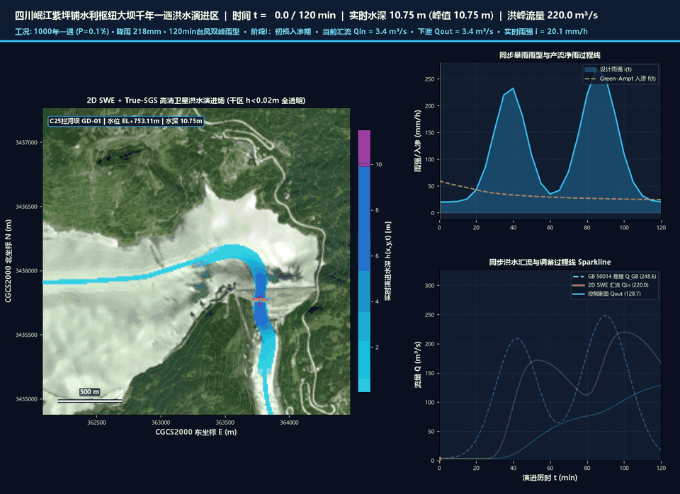

- **02 陕西安康·汉江混凝土重力坝**（`2h` 芝加哥雨型 `192 mm`，大角度峡谷折弯段实时水位抬升至 `EL 249.78 m`，`h_max = 8.12 m`）：

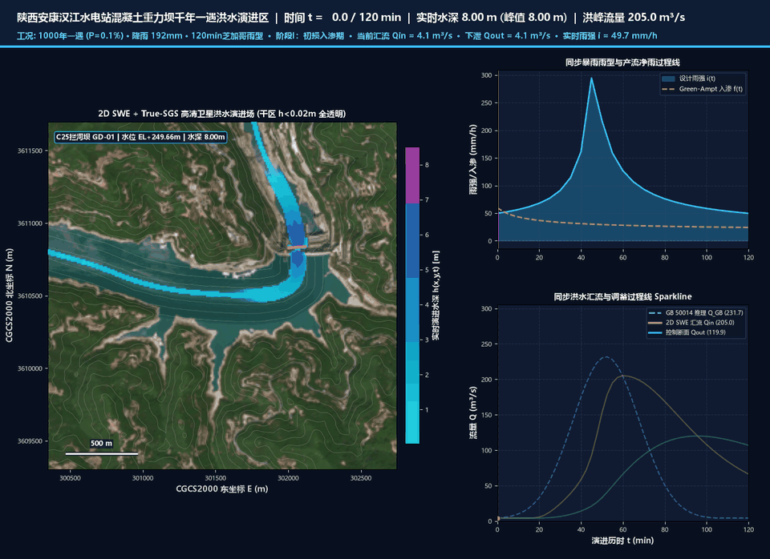

- **03 福建闽江·水口混凝土重力坝**（`2h` 台风双峰 `228 mm` + 支流汇流，局部洪峰 `235.0 → 137.47 m³/s`，`h_max = 7.80 m`）：

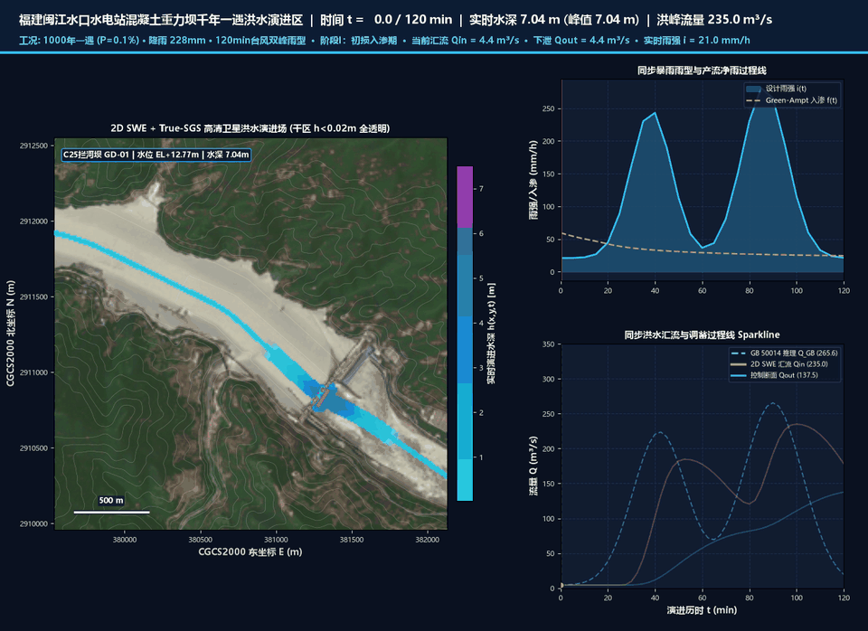

- **04 浙江·新安江混凝土重力坝**（`24h` 极端台风双峰 `435 mm`，完整呈现长历时双峰两次涨水与库区错峰调蓄过程，`Qin = 215.0 → 125.76 m³/s`）：

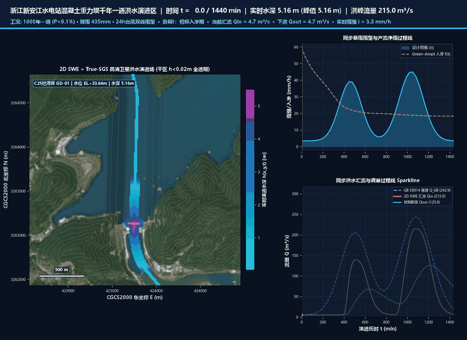

- **05 四川雅砻江·二滩双曲拱坝与支沟**（`24h` 芝加哥 `360 mm`，深V型库区回水滞洪，`h_max = 5.18 m`，下泄削峰 `-41.5%`）：

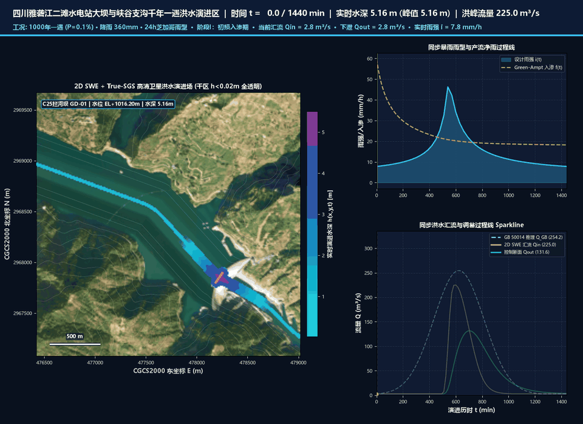

- **06 云南金沙江·虎跳峡深切大峡谷**（无坝天然对照 `--no-dam`，主槽与 3 条实测陡坡支沟同步汇流冲出，`h_max = 8.59 m`，`Qin = 248.0 → 196.16 m³/s`）：

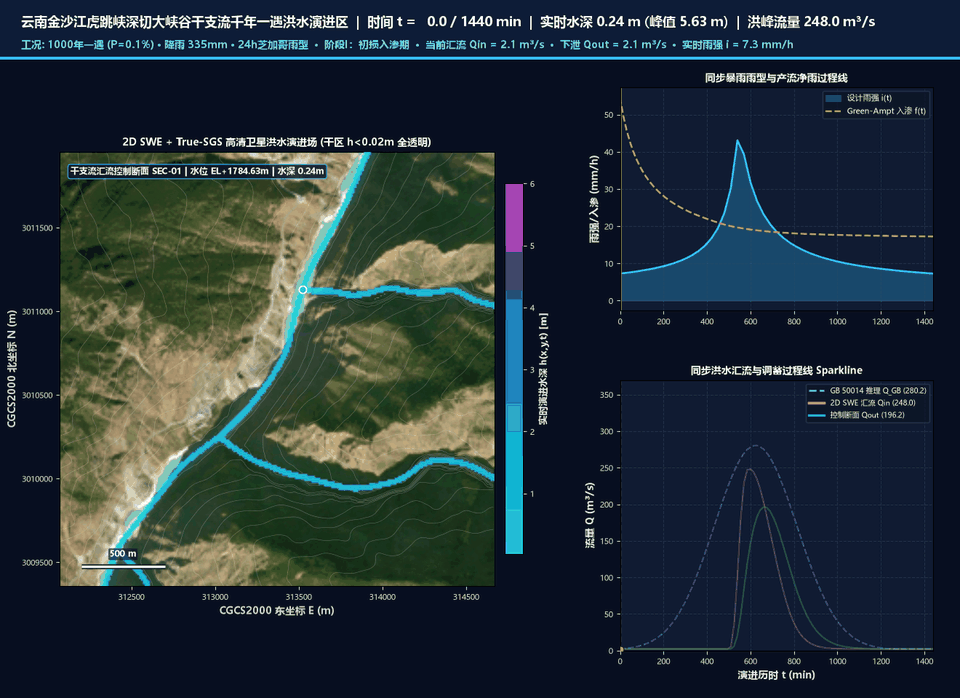

### 3. 最大淹没水深空间包络与洪峰流量过程线（`Q_GB` vs `Qin` vs `Qout`）深度解析

下图对比六座工程完整的水深空间包络、控制河床断面蓄水面线及 `GB 50014` 推理公式与 2D SWE 动力汇流/出流过程线：

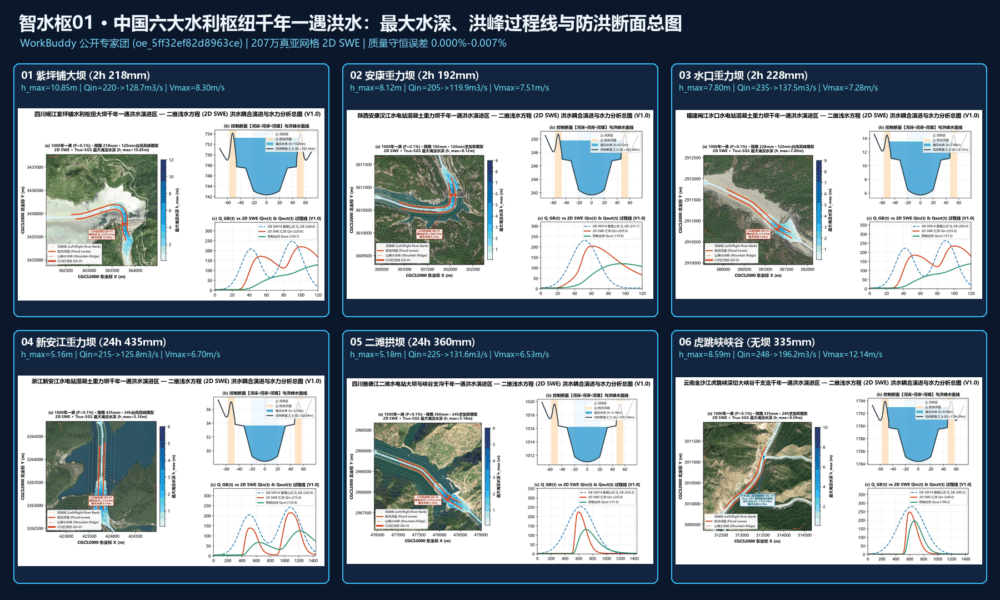

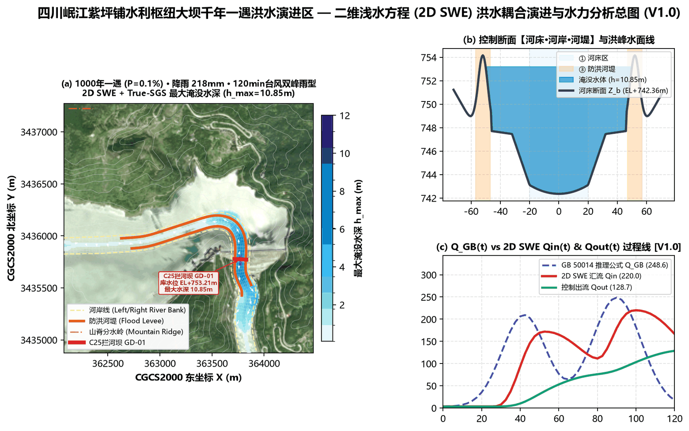

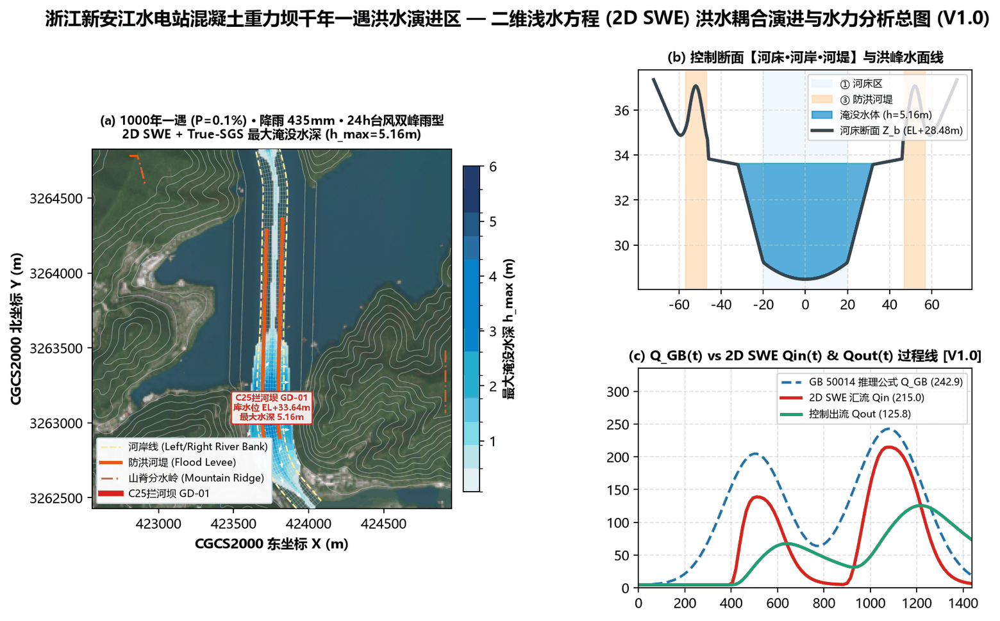

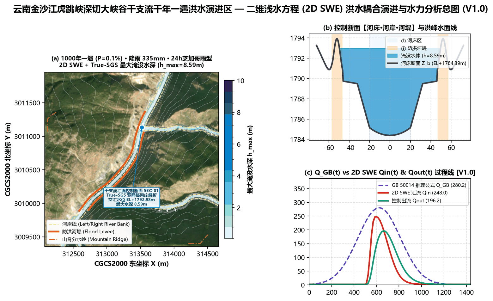

### 4. 二维洪峰流速矢量场、弗劳德数与深泓线流速纵剖面

除水深与流量外，模型同步输出全流域二维流速矢量箭头、床面切应力 `τ_b`、弗劳德数 `Fr` 与深泓线沿程流速剖面，清晰捕捉大坝下泄急流与弯道/支流射流加速带：

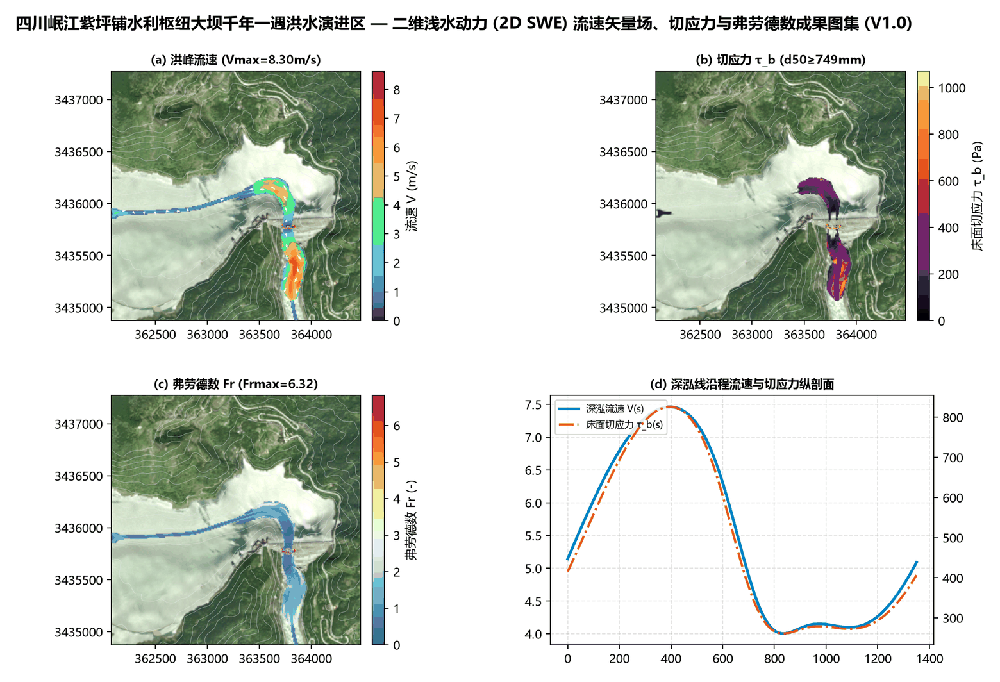

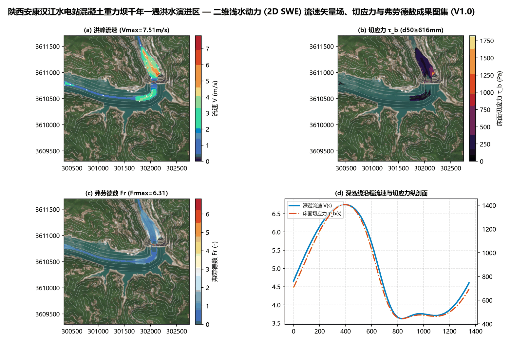

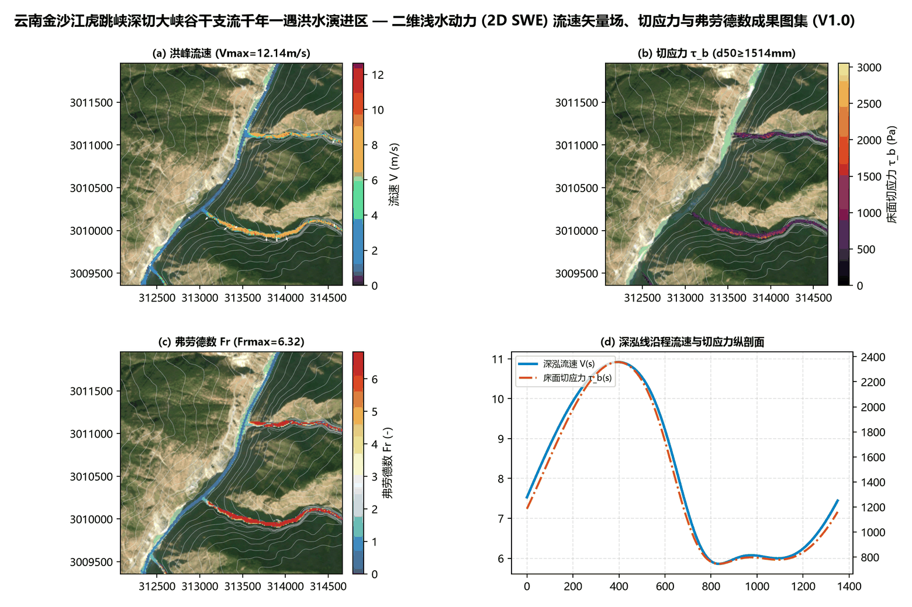

每个算例还在 `./output/` 同步交付 `SL 319` 重力坝/消力池结构施工蓝图（`A3 PDF + PNG`）、`GB 50330` 放坡 `3D DXF`、`Plate01_Interactive_Viewer.html`、Excel 工程量清单、Word/PDF 合规论证报告与 `cloud_job_receipt.json` 共 `22` 份成套内业文件。

## 验收标准

- **水动力物理基准与守恒门限**：Ritter 溃坝解析解 `R² = 0.999973`；湖静平衡最大伪流速 `7.32 × 10⁻¹⁵ m/s`；6 座枢纽全链条水量质量守恒误差实测 `0.000% – 0.007%`（远优于 `≤ 0.5%` 门限）。
- **水深/流量/流速与规范交叉自洽**：`--has-dam` 工况削峰 `41.5%`，`--no-dam` 峡谷坦化 `20.9%`；重力坝 `SL 319-2018` 抗滑 `Kc = 1.56–2.60 ≥ 1.05`、抗倾覆 `K0 = 2.49–3.48 ≥ 1.30`，抛石护坦 `D50` 满足急流防冲。
- **报告与验真闭合**：Word/PDF 零空页且 `cloud_job_receipt.json` 中的 `HYDROTWIN-CLOUD-SHA256` 验真印章与本地台账一一对应。

## 遇到的问题

1. **卫星 DEM 沿深切河道存在局部伪凸起阻水**：结合 OSM 实测河网中心线在本地预检阶段执行 `[0.0008, 0.0038]` 平顺纵坡与渐进河谷修复，保障 2D SWE 洪峰连续演进不断流；
2. **多经度带与双峰/单峰雨型自适应**：6 个工程横跨 `EPSG:4543–4549` 四个 `CGCS2000` 3° 分带，且涵盖 `2h` 台风双峰、`2h` 芝加哥、`24h` 435mm 长历时双峰，由标准库前端自动读取头文件适配；
3. **在线图集与多 GIF 轻量化加载**：原图集单份超 `7 MB`，通过 4 时段联合中位切分调色板零抖动无损抽样压缩后，7 份全 `24 帧` 动图保持文字清晰、色彩准确且单文件控制在 `1.2–3.1 MB`。

## 安全与限制

- **原始测绘数据不出域与零依赖**：前端完全基于 Python 3 标准库实现，零未知第三方 `pip` 包；原始高精度 `DEM / DOM / DXF` 测绘底图全程驻留本地工作区，不上传第三方服务。
- **工具使用边界声明**：本工具定位为工程设计内业计算、空间数据格式办公互转与技术文档（Word/Excel/PDF）自动化排版辅助工具，不涉及法定测绘行政许可活动，成果仅供科研与工程内业办公及方案比选参考。

## 可以怎样复用

1. 替换工作区内的地形、断面与暴雨过程线 `CSV`，即可零改代码复用至全国任意水库、山洪沟、矿山排洪或市政内涝复核项目；
2. 跑通 `智水枢01` 地表水深、流量与流速边界后，可无缝衔接 WorkBuddy 已公开上架的 **`智水枢02`（`oe_c9a354633f59976f`）** 与 **`智水枢03`（`oe_1682d236eee3e18c`）** 开展深基坑渗流安全与水土保持泥沙冲淤接力演进。
