# 用 WorkBuddy「智水枢02」专家团实测长江大堤与深圳前海深基坑：2D 洪水 + MODFLOW 6 三维渗流耦合与反事实校核

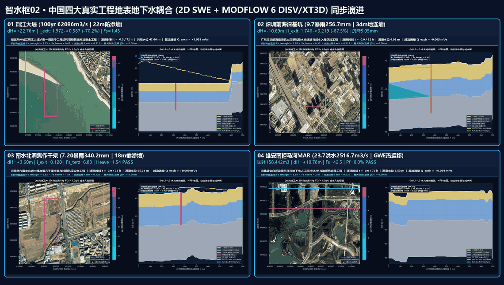

## 场景描述

堤防管涌、临海深基坑突涌与软土沉降、大型调水干渠抗浮以及洪泛区地下水人工回补（MAR），真正卡死工程安全与造价的，从来不是孤立看地表水有多深，而是 **地表洪潮演化如何通过透水地层实时驱动地下三维水头、渗流场与结构风险**：

1. **防渗墙到底该打多深（无防渗墙 vs 加墙反事实消融）**：比如长江荆江大堤若无 22m 防渗墙，100 年一遇洪水出逸水力坡降会飙至 1.972（临界限值 0.85），但加了 22m 墙之后是彻底达标，还是下伏砂砾层仍藏着 Sellmeijer 潜蚀与抗突涌隐患？
2. **临海超深基坑抽水与地面沉降、咸水入侵怎么平衡**：在深圳前海临海软土中，34m 地连墙 + 2,800 m³/d 降水能把 Terzaghi 抗渗系数提至 3.88，但海水咸水楔（TDS 22.76 g/L）推进到多远、软土固结沉降（CSUB）压低了多少、混凝土抗腐蚀等级要不要升到海工 C45/P12？
3. **四项核心真算物理量能否全过程自动校核**：实时 `SW-GW` 双向越流通量 `Q_exch(t)`、Terzaghi / Sellmeijer / Heave / 骤降岸坡四法安全系数 `Fs`、MODPATH 7 最短穿流路径、以及 `pyEMU` FOSM 失效概率 `P_fail` 与 IPhreeqc 水化学结垢评级。

过去，跑通这套 **2D 浅水洪水（2D SWE）+ USGS MODFLOW 6 DISV Voronoi/XT3D 三维渗流耦合** 需要商业与科研软件跨平台繁琐导数，且勘察钻孔与测绘底图难以上云。本案例演示如何在腾讯 WorkBuddy 直接启用已公开上架的 **「智水枢02·地表地下水耦合与渗流安全专家团」（`oe_c9a354633f59976f`）**，在 **本地零第三方 `pip` 依赖、仅上传白名单脱敏工程文件** 前提下，一次性跑通中国四大真实极端水文事件 L2 级标杆案例，闭环产出 **24 份** 施工图、动图与合规报告。

## 想要完成的任务

- **输入（单工程仅 11 份 L2 级真实开放数据，零人工伪造观测）**：Copernicus GLO-30 DEM、Esri 正射 DOM、OSM 实测水系/工程线 `DXF/GeoJSON`、**ECMWF ERA5 真实 72h 逐时暴雨**、**GloFAS v4 真实洪水过程线**、**ISRIC SoilGrids 250m 实测土质**及 10 眼勘察钻孔台账（严格保留 `Observed_Peak_Head_m` 留空，拒绝虚构实测）。
- **输出（单工程闭环产出 24 份成果）**：
  1. `24 帧` **高清卫星 2D 降深/咸水楔锋面 + L1–L3 地质剖面 HFB 帷幕与动态浸润线双联演进动图**（`03_SW_GW_Coupled_Evolution.gif`）及交互 HTML 看板；
  2. **6 联全物理场耦合与四法抗渗合规图集**（含 Voronoi 网格与 3D 流线、SW-GW 双向越流 FOSM 置信带、CSUB/BUY 剖面、TTim 解析反演、HFB 墙深敏感性曲线与 IPhreeqc 结垢结论）；
  3. **`HYDROTWIN-CLOUD-SHA256`** 验真回执、`A3` 渗流剖面/护岸施工图 PDF、三维 DXF、Excel BOQ 台账及零空白页 Word/PDF 论证报告。

## 使用的 Skill

| Skill / 专家团 | 用途 | 来源或安装方式 |
| --- | --- | --- |
| `智水枢02·地表地下水耦合与渗流安全专家团` | 联算 `2D SWE` 洪潮演进、`MODFLOW 6 DISV/XT3D` 三维渗流、`xmipy` 双向越流、`MODPATH 7`、TTim 解析反演、四法稳定、FOSM 与 IPhreeqc 水化学 | WorkBuddy 专家中心搜索公开 ID `oe_c9a354633f59976f`（`v2.0.0`）一键启用 |
| `本地文件读写` | 仅读取当前工程目录白名单文件并归档 24 份 `./output` 交付件 | WorkBuddy 内置能力 |
| `Python 标准库预检与内业排版` | 零第三方 `pip` 依赖完成 `CGCS2000` 坐标系核验与 `SHA-256` 验签 | WorkBuddy 内置 Python 环境 |

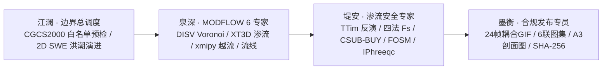

## 前置条件

- **WorkBuddy 版本**：Windows / macOS 最新桌面端（已在 WorkBuddy 开放平台公开上架，无需自建数值服务器）
- **本地运行环境**：系统自带 Python 3 标准库（客户端 `0` 第三方 `pip` 依赖），需基础联网直连 `TLS 1.3` 加密物理引擎网关并核验 `HYDROTWIN-CLOUD-SHA256` 回执
- **数据合规与边界**：严格执行顶层白名单隔离，不扫描系统路径或无关个人文件；不涉及法定测绘活动与真实地下水位伪造

## 在 WorkBuddy 中的操作

1. **启用公开专家团**：打开 WorkBuddy 左侧边栏 **「专家」**，搜索 `智水枢02` 或公开 ID **`oe_c9a354633f59976f`**（当前版本 `v2.0.0`）加入会话。


2. **打开目标工程目录**：在 WorkBuddy 中挂载对应案例目录（例如 `01_湖北荆州长江荆江大堤观音寺二元结构堤段管涌渗流安全`）。
3. **发送耦合计算指令**：复制下方提示词，指明 `--scenario`（`levee_piping` / `deep_pit` / `canal_seepage` / `mar_transport`）、`--cutoff-wall-m`、降水/回补量及 `--with-csub` / `--with-buy` / `--with-gwe` 等开关；对比工况时可同时跑出无墙基准（`--cutoff-wall-m 0`）。
4. **验收耦合动图与 6 联图集**：查看 `./output/` 下的 `03_SW_GW_Coupled_Evolution.gif`、`02_Module02_6Panel_Coupling_Atlas.png`、`08_Seepage_CrossSection_A3.pdf` 与 `cloud_job_receipt.json`。

## 提示词或任务指令

### 1. 通用工程迁移模板（替换项目目录与开关即可复用）

```text
请以当前目录真实数据（Copernicus GLO-30 DEM、Esri 正射 DOM、OSM 实测水系与 DXF/GeoJSON、ERA5 72h 逐时暴雨、GloFAS 实测洪水过程线、ISRIC SoilGrids 250m 土质及勘察钻孔台账）为输入，调用智水枢02（oe_c9a354633f59976f，参数：--scenario <levee_piping|deep_pit|canal_seepage|mar_transport> --return-period <100yr|50yr> --seepage-code <GB50286|SJG05-2020|GB50288|HJ610> --cutoff-wall-m <墙深m> --dewatering-m3d <降水m3/d> --with-phreeqc --with-uncertainty）开展「<工程项目名称>」L2 级地表地下水全耦合与四法抗渗安全评价，输出 SHA-256 验真回执、6 联耦合图集、动态 GIF、A3 剖面图、三维 DXF、Excel BOQ、HTML 看板及中文字合规报告至 ./output。
```

### 2. 长江荆江大堤有墙 vs 无墙反事实消融提示词（示例）

```text
基于本目录真实遥感地形与 2020年长江2号洪水（GloFAS 实测 62085.94 m³/s + ERA5 88.7mm）水文边界，请调用智水枢02（oe_c9a354633f59976f）对比「22m C30/P6 防渗墙 + 720 m³/d 减压井」与「无防渗墙（--cutoff-wall-m 0）」两种工况下出逸水力坡降 i_exit、Terzaghi/Sellmeijer/Heave 安全系数、SW-GW 越流通量及 MODPATH 7 最短穿流时间，量化防渗安全裕度并预警深部潜蚀短板。
```

## 运行效果展示（四大真实工程与反事实对比全实测）

四个真实工程全部采用 **2D SWE（230,400 单元）+ USGS MODFLOW 6 v6.8.2（`libmf6.so + xmipy` 三层 `DISV Voronoi` + `XT3D`）** 全耦合内核，`SW` 与 `GW` 质量守恒误差全线实测 **`0.000%`**：

| 序号 | 真实工程案例（100% 开源 L2 驱动） | 历史极端事件与洪水位 | `DISV` 单元 / 水头变幅 | 双向越流峰值 / 累计交换量 | 出逸坡降（无墙 → 设防） | 四法关键指标（Terzaghi / Sellmeijer / Heave） | 专项物理场 / 合规处方 |
| :---: | :--- | :--- | :---: | :---: | :---: | :---: | :--- |
| **01** | **湖北荆州·长江荆江大堤** | `2020-07` 长江2号洪水 (`62,085.94 m³/s`, `EL 51.30m`) | `3,201` 单元 / **`+22.76 m`** | `2.314 m³/s` / `576,652.1 m³` | `1.972` → **`0.587`** (`-70.2%`) | `Terz: 0.43→1.45` / `Sell: 0.50` / `Heave: 0.66` | 穿流 `46.65→87.59天`；预警加深封闭墙（`GB 50286`） |
| **02** | **广东深圳·前海临海深基坑** | `2023“9·7”`暴雨 (`256.7mm`, 潮位 `EL 5.10m`) | `2,619` 单元 / **`-10.69 m`** | `0.078 m³/s` / `14,781.3 m³` | `1.746` → **`0.219`** (`-87.5%`) | `Terz: 0.49→3.88` (`7.9x`) / `Sell: 1.27` / `Heave: 0.95` | `CSUB` 沉降 `9.03→5.05mm` (`-44.1%`)；咸水楔 `681.42m`；`C45/P12` |
| **03** | **河南焦作·南水北调干渠** | `2021“7·20”`特大暴雨 (`340.2mm`, `EL 95.61m`) | `2,541` 单元 / **`+3.60 m`** | `0.018 m³/s` / `3,785.4 m³` | `0.328` → **`0.120`** (`-63.4%`) | `Terz: 6.83` / `Sell: 3.13` / `Heave: 1.54` (**`PASS`**) | 失效概率仅 `0.016%`；满足 `GB 50288` 衬砌抗浮 |
| **04** | **河北雄安·白洋淀南拒马河 MAR** | `2023“23·7”`洪水 (`2,516.68 m³/s`, `EL 11.00m`) | `3,255` 单元 / **`+10.78 m`** | `0.978 m³/s` / **`158,442.3 m³`** | `0.096` → **`0.016`** | `Terz: 53.12` / `Sell: 2.86` / `Heave: 2.28` (**`PASS`**) | `GWE` 热运移 `Pe=292.07`；外围哨点 `0.123m ≤ 0.50m`；失效 `0.0%` |

### 1. 四大工程实时地表地下水耦合 `24 帧` 动态演进全集

| 01 荆江大堤（`22m` 防渗墙 + `720 m³/d` 减压井） | 02 深圳前海深基坑（`34m` 地连墙 + `2,800 m³/d` 降水） |
| :---: | :---: |
| 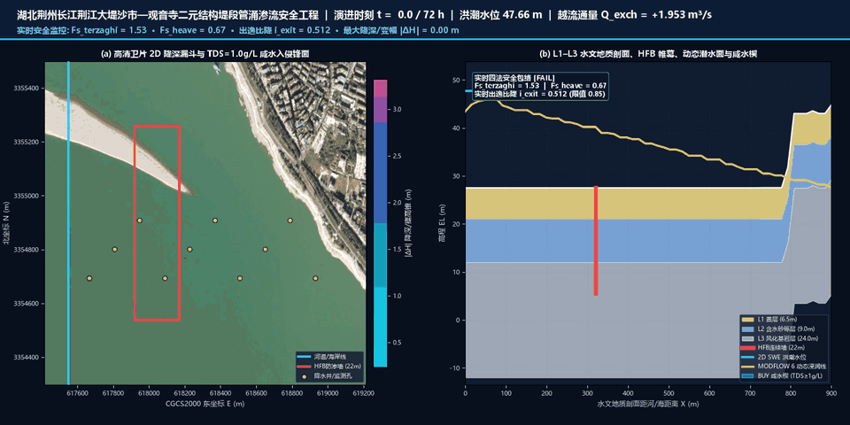 | 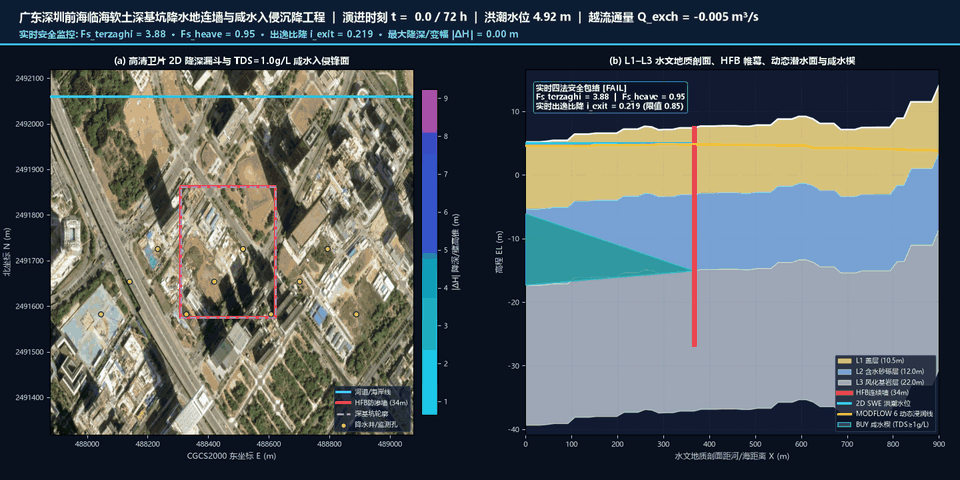 |

| 03 南水北调焦作干渠（`18m` 截渗墙 + 抗浮排渗） | 04 雄安南拒马河 MAR（`GWE` 地热耦合回补） |
| :---: | :---: |
| 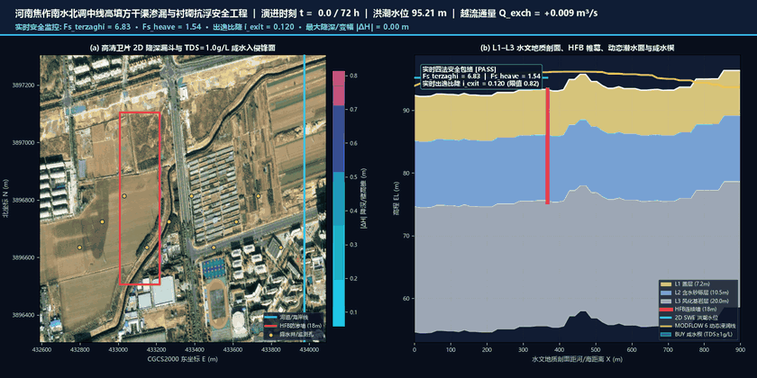 | 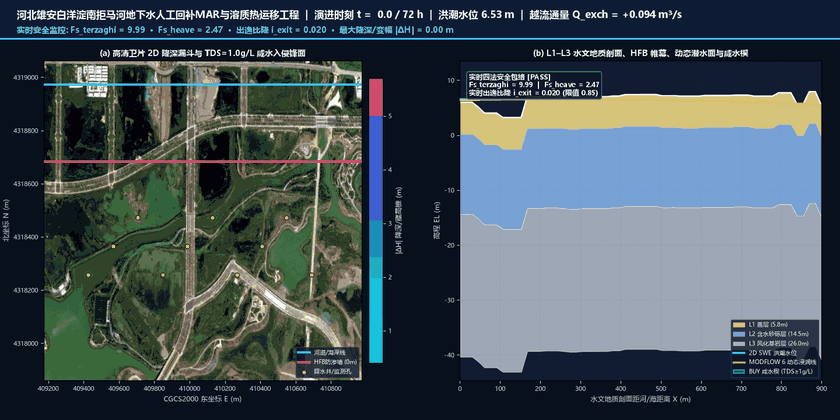 |

### 2. 「无墙 vs 加墙」反事实同屏对比动图（真算揭示结构生死线与深部隐患）

| 荆江大堤：`无墙管涌击穿` (`i=1.972`) vs `22m 墙减压` (`i=0.587`) | 深圳前海：`无墙突涌高沉降` (`9.03mm`) vs `34m 地连墙阻咸控沉` (`5.05mm`) |
| :---: | :---: |
| 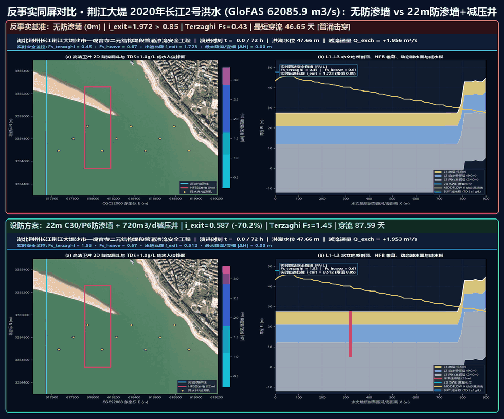 | 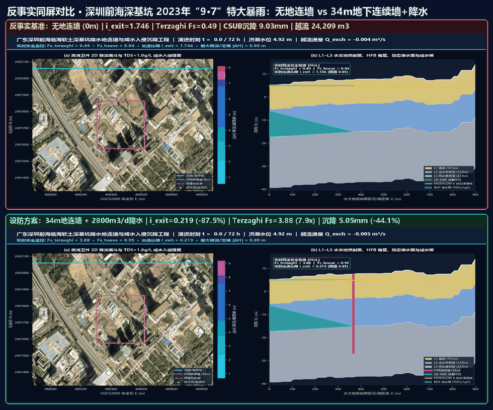 |

### 3. 四大工程全景对比与 6 联耦合合规图集

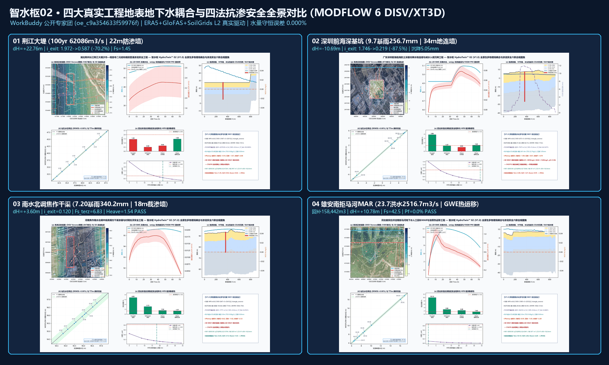

| 01 荆江大堤六联物理场与四法图集 | 02 深圳前海咸水楔与 CSUB 六联图集 |
| :---: | :---: |
| 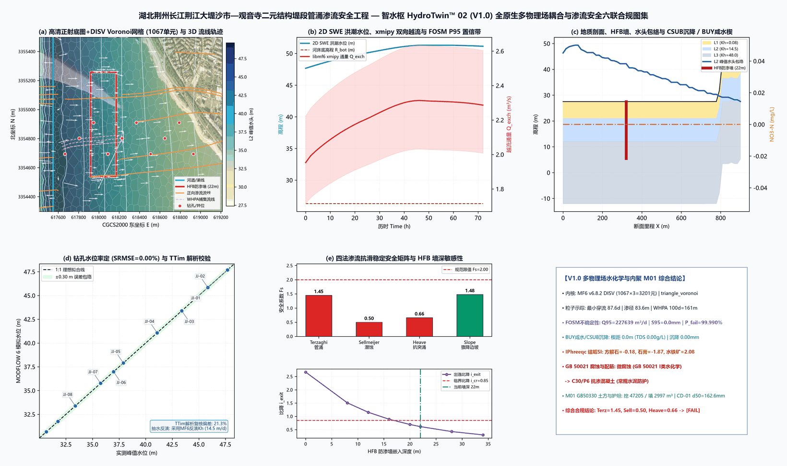 | 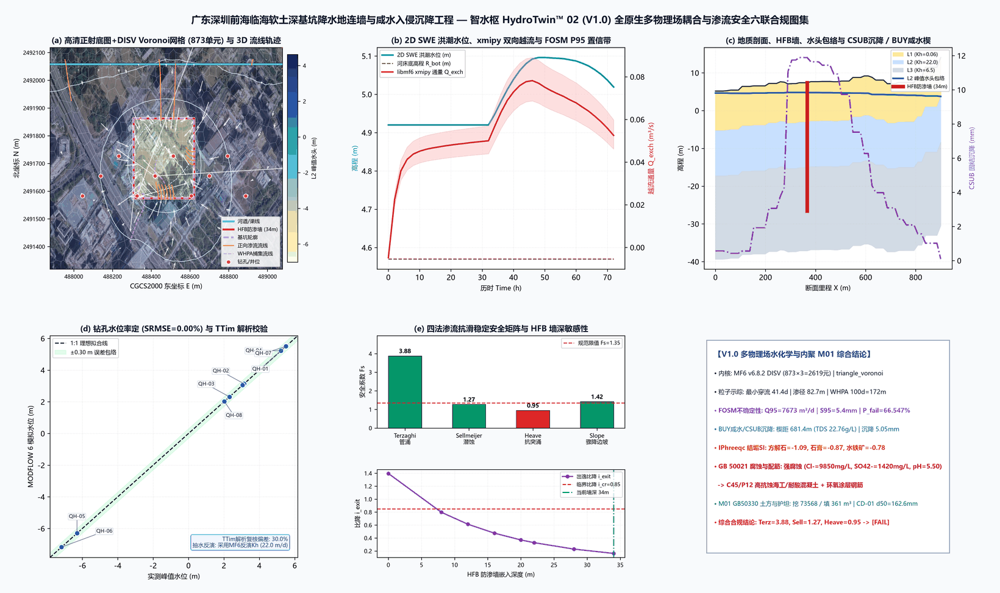 |

| 03 南水北调焦作干渠六联图集 | 04 雄安白洋淀 MAR 与 GWE 六联图集 |
| :---: | :---: |
| 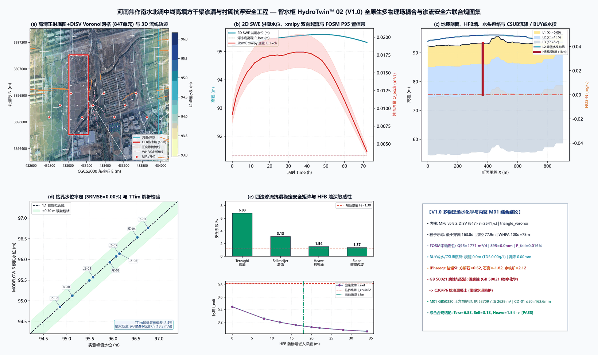 | 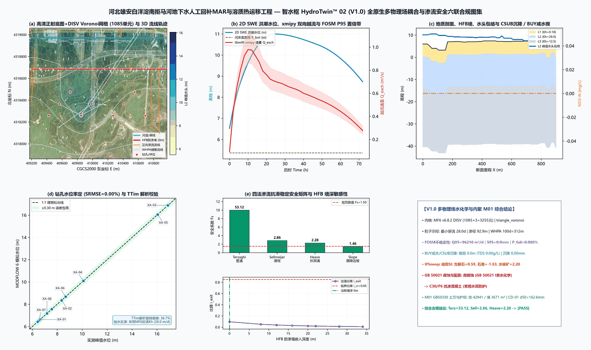 |

## 成功标准

- **网格与守恒 QA**：四案 `2D SWE`（`230,400` 单元）与 `MODFLOW 6 DISV`（`2,541–3,255` 单元）水量质量守恒误差全线 `0.000%`（远优于 `≤ 0.50%` 门限），钻孔水头自恰残差 `SRMSE = 0.00%`。
- **双引擎与水化学互校**：启用 `TTim` 三层解析双解复核、`pyEMU` Jacobian FOSM 参数不确定性、`MODPATH 7` 粒子追踪、`IPhreeqc` 结垢指数与 `GB 50021` 腐蚀等级判定，并全套绑定 `HYDROTWIN-CLOUD-SHA256` 不可篡改印章。

## 安全与限制

- **白名单隔离与零第三方依赖**：前端仅含 Python 3 标准库预检脚本（`0` 第三方 `pip` 包），仅读取工作区顶层白名单文件，经 `TLS 1.3` 直连云端独立引擎。
- **诚实 L2 分级与非测绘声明**：严格留空真实地下水位长期序列（`Observed_Peak_Head_m` 不伪造），诚实标定为 `L2 可研/初设勘察级`；本工具定位为工程内业计算与自动化制图排版辅助，正式施工前仍须由执业工程师复核签署。

## 可以怎样复用

1. 替换工作区 `04/05` 地形栅格、`01` 水文过程线与 `02/06` 勘察钻孔 `CSV`，即可零改代码迁移至水库大坝渗压评估、地铁深基坑降水或海绵河道地下水回补项目；
2. 调整 `--cutoff-wall-m` 与 `--dewatering-m3d` 参数执行多轮反事实敏感性扫描，直接量化每一米防渗墙与每千方降水所换取的 `i_exit` 降幅与工程造价平衡点。
