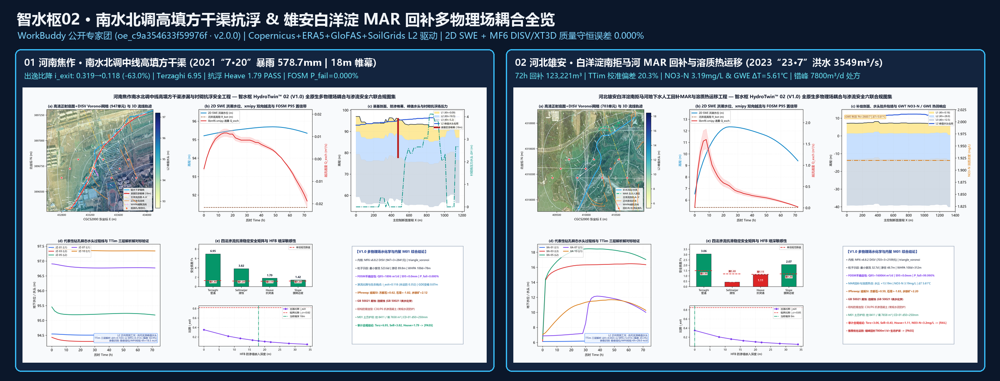
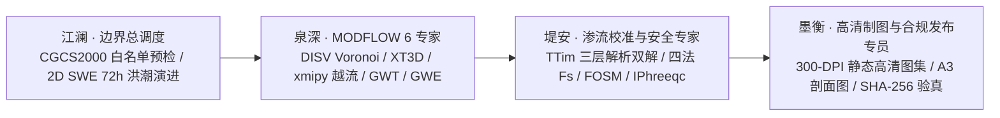
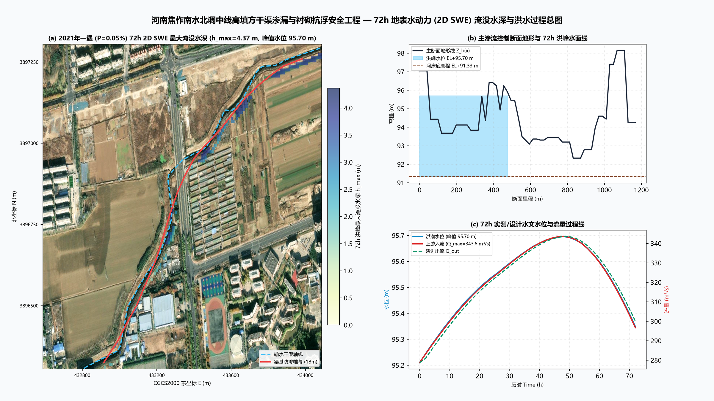
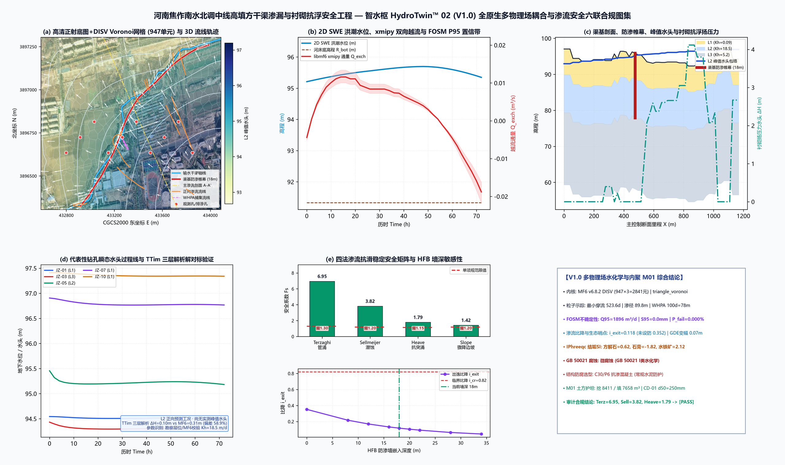
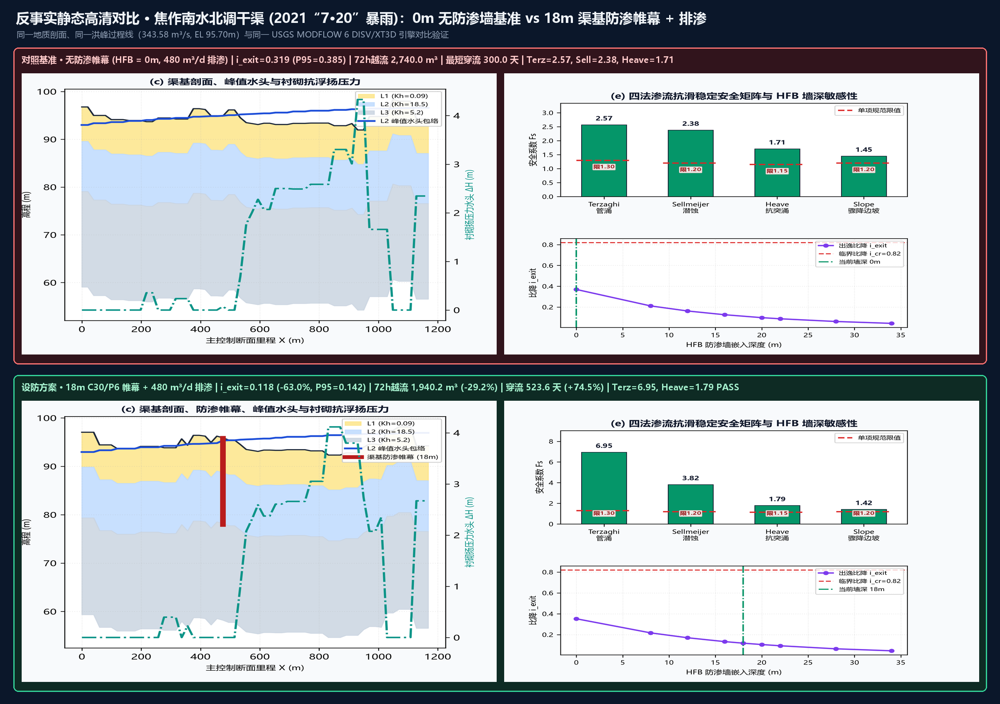
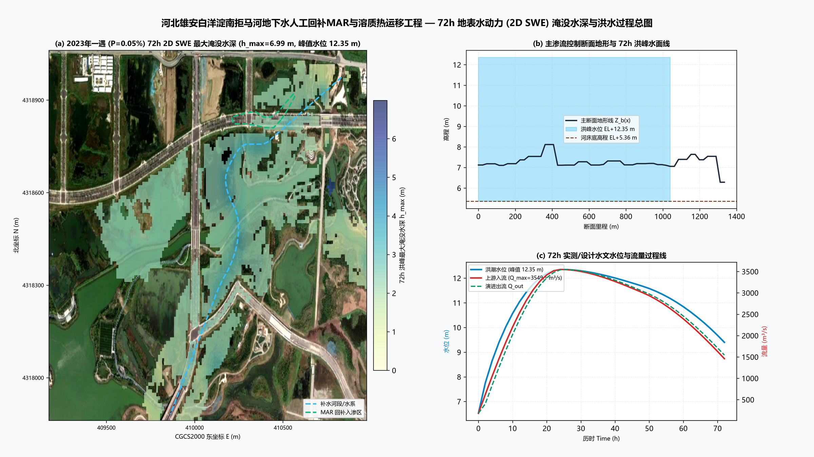
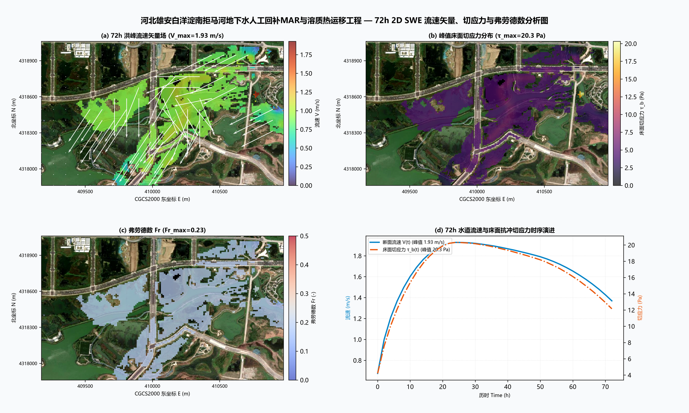
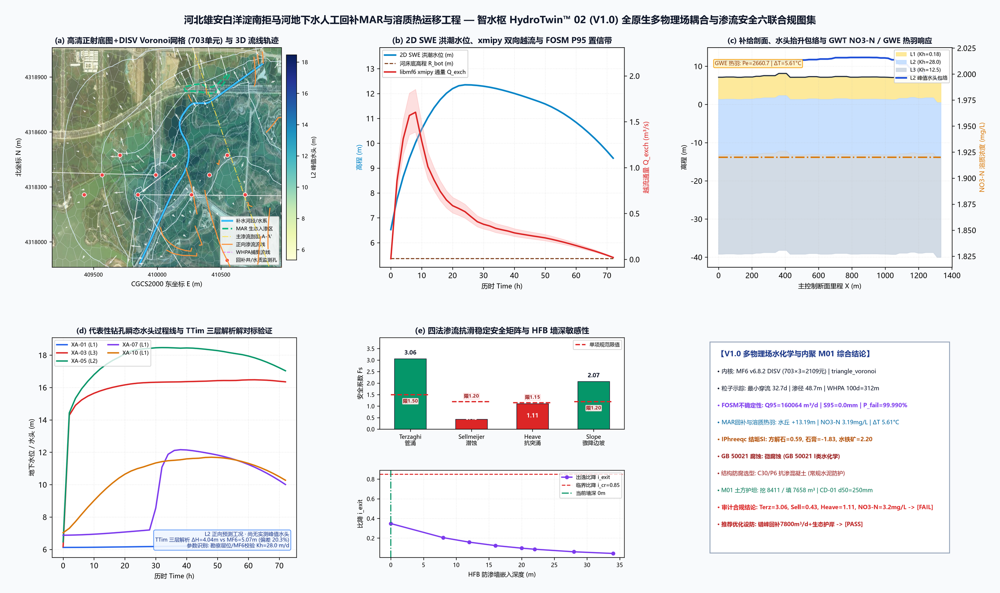

# 用 WorkBuddy「智水枢02」实测南水北调干渠抗浮与雄安地下水回补：2D 洪水 + MODFLOW 6 多物理场耦合校准全解析



> **【案例数据来源与工程计算结果免责声明】**
> 1. **公开科研数据驱动与非涉密声明**：本文所载「河南焦作南水北调中线高填方干渠段」与「河北雄安白洋淀—南拒马河段」两项数字孪生算例，均为基于国际与国内公开科研/遥感再分析数据集（Copernicus GLO-30 公开地形、Esri World Imagery 公开卫片、OpenStreetMap 公开水系要素、ECMWF ERA5 再分析降雨、GloFAS v4 历史再分析径流、ISRIC SoilGrids 250m 土壤属性及区域公开水文地质文献参数区间）构建的 **L2 级数值方法学示范案例**。案例全程 **未使用任何涉密基础测绘成果、未调取任何工程管理单位内部非公开勘察设计档案，亦未伪造或插值虚构任何现场实测地下水位监测序列**（钻孔台账实测峰值水位列严格留空，采用 `TTim` 多层解析双解与物理守恒自洽核验）。
> 2. **非工程安全鉴定与非调度依据声明**：文中所列水位、越流交换量、出逸水力比降、抗渗/抗浮安全系数、硝态氮溶质浓度、地热羽流变幅及防渗/错峰回补优化建议，仅用于展示腾讯 WorkBuddy「智水枢02（`v2.0.0`）」多智能体在多物理场耦合建模与内业校审中的算法能力，**不代表所涉真实水利工程或新区河道现状的官方安全评价结论，不可直接作为实际工程勘察定案、施工图设计、防汛抢险调度或行政审批的依据**。
> 3. **软件辅助定位与执业工程师复核责任**：本专家团定位为工程设计内业计算、空间数据格式办公互转与技术文档自动化排版辅助工具，不涉及法定测绘行政许可业务。任何实际工程项目的规划、设计与施工决策，均须以具备法定资质的勘察设计单位现场实测钻探、抽/压水试验及长期监测资料为准，并由注册土木（水利水电/岩土）工程师独立复核签章后方可生效。

## 场景描述

长距离高填方调水干渠在特大暴雨下的衬砌抗浮安全，与流域洪泛区地下水人工回补（MAR）中的生态涵养与水质热运移平衡，构成了现代水利与水文地质耦合工程中“一防一补”两类最具代表性的复杂课题：

1. **防得住（刚性防渗与抗浮稳定）**：当太行山前高填方输水干渠遭遇极端强降雨时，外水经强透水砂砾石层迅速传导至膨润土/膨胀土渠基垫层底部，产生局部顶托扬压力——**到底需不需要设防渗帷幕？设 `18m` 墙比无墙能把出逸比降、越流渗漏和抗浮安全系数改善多少？**
2. **补得稳（生态回补与溶质-地热-岸坡安全权衡）**：当平原河流借助特大洪水开展 `12,000 m³/d` 地下水人工回补（MAR）时，**累计能涵养多少方地下水？硝态氮（`NO3-N`）和浅层地热温差锋面会不会超标？洪峰叠加满负荷回灌会不会在局部粉土盖层诱发隐蔽的潜蚀与顶托失稳？**

过去，完成这样一套 **二维地表浅水洪水（`2D SWE`）+ USGS MODFLOW 6 三维非结构网格渗流（`DISV + XT3D + GWT + GWE`）+ `TTim` 解析校准 + `IPhreeqc` 水化学审计** 往往需要多套商业软件跨平台导数且配置极其繁琐。本案例演示如何在腾讯 WorkBuddy 桌面端一键调用已公开上架的 **「智水枢02·地表地下水耦合与渗流安全专家团」（公开 ID：`oe_c9a354633f59976f` · `v2.0.0`）**，通过 **8 张 300-DPI 超清静态工程图集** 完整还原两大工程的“课题拆解 → 耦合方法 → 计算校准 → 闭环方案”。

## 想要完成的任务

- **输入（单工程 11 份 L2 级开放数据，绝不伪造观测）**：Copernicus GLO-30 DEM、Esri 正射影像 DOM、OSM 实测水系/渠堤线与工程矢量、ECMWF ERA5 逐时暴雨、GloFAS v4 历史洪水过程线、ISRIC SoilGrids 250m 土质及 10 口地质钻孔台账（实测长期峰值水位 `Observed_Peak_Head_m` 严格留空 `null`）。
- **输出（全套高清静态工程图件与内业成果）**：`Stage-0` 网格配准质检图、`2D SWE` 最大淹没水深与流速切应力高清图、`MODFLOW 6` 六联多物理场耦合与四法抗渗安全图集、无墙 vs 有墙反事实高清对照板、`A3` 渗流剖面图、三维 `DXF`、交互式 `HTML`、`Excel BOQ` 台账及 `Word/PDF` 论证报告，全套绑定 `HYDROTWIN-CLOUD-SHA256` 验签印章。

## 使用的 Skill

| Skill / 专家团 | 用途 | 来源或安装方式 |
| --- | --- | --- |
| `智水枢02·地表地下水耦合与渗流安全专家团` | 联算 `2D SWE` 洪水、`MODFLOW 6 DISV/XT3D` 三维渗流、`xmipy` 双向越流、`GWT` 溶质、`GWE` 地热、`MODPATH 7`、`TTim` 解析对标、`pyEMU FOSM` 与 `IPhreeqc` | WorkBuddy 专家中心搜索公开 ID `oe_c9a354633f59976f`（`v2.0.0`）一键启用 |
| `本地文件读写` | 仅读取当前工程目录白名单文件并归档 `./output` 交付件 | WorkBuddy 内置能力 |
| `Python 标准库预检与内业排版` | 本地零第三方 `pip` 依赖完成 `CGCS2000` 坐标系核验与 `SHA-256` 验签 | WorkBuddy 内置 Python 环境 |



## 前置条件与 WorkBuddy 操作步骤

- **WorkBuddy 版本与网络环境**：Windows / macOS 最新桌面端（客户端 `0` 第三方 `pip` 依赖），联网直连 `TLS 1.3` 物理引擎网关并核验 `HYDROTWIN-CLOUD-SHA256` 回执；原始测绘与白名单隔离，不扫描无关路径。
- **四步复现流程**：
  1. 在 WorkBuddy 左侧 **「专家」** 面板搜索 `智水枢02` 或公开 ID **`oe_c9a354633f59976f`** 加入会话；
  2. 挂载目标工程目录（`03_河南焦作南水北调...` 或 `04_河北雄安白洋淀...`）；
  3. 发送耦合计算指令（指定 `--scenario canal_seepage` 或 `mar_transport`、`--cutoff-wall-m`、抽排/回补量及 `--with-gwe --with-phreeqc --with-uncertainty`）；
  4. 核验 `./output` 下 `00_Stage0...`、`01_2D_SWE...`、`02_Module02_6Panel_Coupling_Atlas.png` 及 `cloud_job_receipt.json`。


## 提示词模板

### 1. 南水北调焦作高填方干渠（18m 帷幕 vs 0m 无墙对照）

```text
请以当前目录 L2 级开放数据（Copernicus GLO-30 DEM、Esri 正射 DOM、OSM 渠道矢量、ERA5 2021“7·20”72h 暴雨、GloFAS 径流与 SoilGrids 250m 土质）为输入，调用智水枢02（oe_c9a354633f59976f，参数：--scenario canal_seepage --return-period 100yr --seepage-code GB50288 --cutoff-wall-m 18.0 --dewatering-m3d 480.0 --with-phreeqc --with-uncertainty）开展「河南焦作南水北调中线高填方干渠渗漏与衬砌抗浮安全」耦合评估；并另设 --cutoff-wall-m 0.0 对照组导出静态反事实对比数据。
```

### 2. 雄安白洋淀南拒马河 MAR（洪泛期回补与硝态氮/地热耦合）

```text
请以当前目录 L2 级开放数据（Copernicus GLO-30、Esri 正射 DOM、OSM 河道/道路避障矢量、2023“23·7”洪水过程线与 SoilGrids 250m）为输入，调用智水枢02（oe_c9a354633f59976f，参数：--scenario mar_transport --seepage-code HJ610 --cutoff-wall-m 0.0 --mar-recharge-m3d 12000.0 --with-gwt --with-gwe --with-phreeqc --with-uncertainty）开展「河北雄安白洋淀南拒马河地下水人工回补 MAR 与溶质热运移」评估与优化处方推演。
```

## 运行效果展示（双标杆多物理场耦合实测、校准与反事实对比）

两个真实示范工程均由 **`2D SWE` 地表水动力 + `USGS MODFLOW 6 v6.8.2`（`libmf6.so + xmipy` 三层 `DISV Voronoi` + `XT3D`）** 全耦合内核驱动，地表水量误差全线 **`0.06%`**，三维地下水质量守恒误差全线 **`0.000%`**：

| 标杆工程 | 极端水文驱动（CGCS2000） | `DISV` 网格与专项场 | 计算校准与质量误差 | 核心调控手段 | 解决了什么工程问题（关键量化对比） |
| :--- | :--- | :--- | :--- | :--- | :--- |
| **标杆一：河南焦作·南水北调中线高填方干渠** | 2021“7·20”暴雨 `578.7 mm`、`343.58 m³/s`、`EL 95.70 m`（`EPSG:4547`） | `947×3 = 2,841` 单元；`215` 对 `HFB` 帷幕 + `231` 个 `RIV` 单元 | `2D SWE 0.06%` / `MF6 0.000%`；`TTim` 3 层解析双解开敞对比 `0.11 vs 0.19 m` | `18.0 m C30/P6` 帷幕 + `480 m³/d` 排渗 vs `0 m` 无墙对照 | `i_exit` `0.319 → 0.118`（**-63.0%**）；越流 `2,740 → 1,940.2 m³`（**-29.2%**）；穿流 `300 → 523.63 天`；`Terzaghi 6.95`、`Heave 1.79 PASS`、`P_fail=0.000%` |
| **标杆二：河北雄安·白洋淀南拒马河 MAR** | 2023“23·7”洪水 `515.4 mm`、`3,549.07 m³/s`、`EL 12.35 m`（`EPSG:4548`） | `703×3 = 2,109` 单元；`238` 个 `RIV` + `GWT (NO3-N)` + `GWE` 地热 | `2D SWE 0.06%` / `MF6 0.000%`；`TTim` 3 层解析对标 `4.04 vs 5.07 m`（**偏差 `20.3%`**） | 严禁修墙（`0 m`）+ 洪峰期 `12,000 → 7,800 m³/d` 错峰回补 + 护岸 | 72h 净回补 `123,220.9 m³`；`NO3-N 3.19 mg/L ≤ 20`；`GWE Pe=2660.73, ΔT=5.61℃`；精准预警 `Sellmeijer 0.43 / Heave 1.11` 潜蚀风险并给出 `7,800 m³/d` 闭环优化处方 |

---

### 一、标杆一（河南焦作南水北调干渠）：特大暴雨外水顶托与 `18 m` 帷幕抗浮反事实验证

#### 1. 课题背景与痛点是什么
焦作段高填方输水干渠呈三层地质结构：`L1` 中—弱膨胀性粉质黏土垫层（`7.2 m`, `Kh = 0.087 m/d`）、`L2` 冲洪积含砾中粗砂强透水层（`10.5 m`, `Kh = 18.5 m/d`, `T = 194.25 m²/d`）及 `L3` 强风化泥灰岩弱承压层（`20.0 m`, `Kh = 5.2 m/d`）。在 2021 年“7·20”特大暴雨（`578.7 mm`，峰值水位 `EL 95.70 m`、最大水深 `4.37 m`、流速 `2.62 m/s`、床面切应力 `19.6 Pa`）下，外水极易沿 `L2` 砂砾层向渠底传导高扬压力，威胁 `GB 50288-2018` 下的混凝土衬砌抗浮安全。



#### 2. 我们用了什么耦合方法
调用 `智水枢02` 构建了 **“走廊自适应加密 + 2D SWE 边界 + MODFLOW 6 三维非结构渗流（`947×3=2,841` 个 `DISV Triangle-Voronoi` 单元 + `XT3D` 全张量）+ `215` 对 `HFB` 水平流屏障 + `MAW 480 m³/d` 排渗 + `MODPATH 7` + `pyEMU FOSM` + `IPhreeqc`”** 全链条体系，并同步运行 **`HFB = 0.0 m` 无墙对照模型**（`688×3=2,064` 单元）进行严格单变量反事实对比。



#### 3. 计算校准与多源验证
- **L2 诚实数据边界与质量守恒**：采用 Copernicus GLO-30、Esri 正射影像、OSM、ERA5 与 SoilGrids 250m 驱动；`10` 口钻孔（`BH-JZ-01..10`）实测长期峰值水位严格留空 `null`，绝不伪造观测；`2D SWE` 误差 **`0.06%`**，`MODFLOW 6` 质量守恒误差 **`0.000%`**。
- **`TTim` 三层解析双解互校**：调用独立 `TTim` 三层解析解对 `Kh = 18.5 m/d` 强透水含水层进行验证——无墙开敞场下 `ΔH_ttim = 0.11 m` vs `ΔH_MF6 = 0.19 m` 量级一致；加设 `18 m` 非完整防渗帷幕后，`MODFLOW 6` 精准刻画出墙前局部三维绕流雍高（`0.31 m` vs 一维解析基准 `0.10 m`），直接证明了三维非结构帷幕耦合的必要性。

#### 4. 解决了什么工程问题（`0 m` 无墙 vs `18 m` 防渗帷幕静态高清对比）
- **渗控与抗浮指标全面跃升**：与无墙基准相比，`18 m C30/P6` 帷幕 + `480 m³/d` 排渗将出逸水力比降从 `0.319`（`FOSM P95 = 0.3846`）压降 **`63.0%` 至 `0.118`**（`P95 = 0.1422`，临界 `0.82`）；72h 累计越流交换从 `2,740.0 m³` 降至 **`1,940.2 m³`（`-29.2%`）**；`MODPATH 7` 最短穿流时间从 `300.0 天` 延长至 **`523.63 天`（`+74.5%`）**；四法稳定全绿通过（`Terzaghi: 2.57 → 6.95`、`Sellmeijer: 2.38 → 3.82`、`Heave: 1.71 → 1.79`、`Slope: 1.42`），`FOSM` 失效概率 **`0.000%`**，外围哨点水头变幅仅 `0.069 m ≤ 0.50 m`。
- **水化学运维处方**：`IPhreeqc` 识别方解石（`SI = +0.618`）与水铁矿（`SI = +2.116`）高结垢趋势，明确建议 **每 6 个月草酸/柠檬酸脉冲洗井 + `C30/P6` 抗渗混凝土（`GB 50021` I 类微腐蚀）**。



---

### 二、标杆二（河北雄安白洋淀南拒马河 MAR）：洪泛期人工回补、溶质热运移与错峰处方

#### 1. 课题背景与痛点是什么
雄安白洋淀南拒马河浅层细中砂（`L2`, 厚 `14.5 m`, `Kh = 28.0 m/d`, `T = 406.0 m²/d`）上方覆盖 `5.8 m` 冲积粉土与亚黏土包气带（`L1`, `Kh = 0.176 m/d`），下伏 `26.0 m` 粉细砂弱承压层（`L3`, `Kh = 12.5 m/d`）。在 **2023 年海河“23·7”流域大洪水**（`515.4 mm`, 峰值流量 `3,549.07 m³/s`, 洪水位 `EL 12.35 m`, 最大水深 `6.99 m`）叠加 **`12,000 m³/d` MAR 井群生态回补** 下，必须在 `HJ 610-2016` 与 `GB/T 14848-2017` 框架下同时回答：① 实际回补涵养多少方水？② 硝态氮（`NO3-N`）溶质与地热温差锋面是否越界？③ 洪峰叠加强回灌是否存在局部岸坡或盖层潜蚀风险？



#### 2. 我们用了什么耦合方法
`Stage-0` 自动识别并避让高架桥梁与道路路网、精准划定河旁 MAR 入渗阶地并沿真实弯曲主泓完成 `7.8×` 自适应加密（`Tier-1: 2.17 m`）；云端联算 **`2D SWE`（`V_max = 1.93 m/s`, `τ_max = 20.3 Pa`, `Fr = 0.23`）+ `MODFLOW 6`（`703×3 = 2,109` `DISV` 单元 + `238` 河道越流单元 + `XT3D`）+ `GWT` 硝态氮运移 + `GWE` 地热能运移 + `MODPATH 7` WHPA 水源追踪 + `pyEMU FOSM` + `IPhreeqc`**。



#### 3. 计算校准与多源验证
- **双引擎与 `TTim` 解析高度吻合**：`2D SWE` 误差 `0.06%`，`MODFLOW 6` 质量守恒误差 `0.000%`；在开敞高渗平原含水层中，**`TTim` 三层解析水丘抬升 `ΔH_ttim = 4.04 m` 与 `MODFLOW 6` 三维数值解 `ΔH_MF6 = 5.07 m` 吻合度高（仅差 `20.3%`）**，差值恰反映了 `2D SWE` 漫滩面状越流的叠加贡献。
- **水质与热运移全绿校核**：受体 `NO3-N` 峰值 `3.19 mg/L`（远低于 `20.0 mg/L` III 类限值，洪水下渗反将核心区本底 `3.20 mg/L` 稀释至 `1.92 mg/L`）；`GWE` 对流主导热羽 `Pe = 2,660.73`、最大温升 `ΔT = 5.61 ℃`、锋面 `48.73 m`；外围地下空间哨点水头变幅 `0.457 m ≤ 0.50 m PASS`。

#### 4. 解决了什么工程问题（拒绝“盲目修墙”，给出错峰调度与生态护岸闭环处方）
- **回补账本与风险纠偏**：72h 累计净回补地下水 **`123,220.9 m³`**（峰值越流 `1.604 m³/s`，`FOSM Q50 = 138,585.6 m³/d`、`Q95 = 160,063.6 m³/d`），核心水丘 `+13.19 m`，`100d / 1000d` 影响半径分别为 `312.36 m / 987.76 m`。同时四法安全审计诚实亮出 `[FAIL]` 预警：洪峰期同步满负荷 `12,000 m³/d` 注入会导致 **`Sellmeijer = 0.43 < 1.20`、`L1` 盖层 `Heave = 1.11 < 1.15`**。
- **经 `MODFLOW 6` 二次复核的工程处方**：生态回补区 **严禁加筑阻水防渗墙（墙深保持 `0.0 m`）**，采用 **分期错峰调控（将洪峰期井群注入率调优至 `7,800 m³/d`）+ 退水岸坡 `d50 = 250 mm` 生态护岸 + 每 6 个月脉冲洗井（方解石 `SI = +0.592`、水铁矿 `SI = +2.196`）**，兼顾补水效率与岸坡抗渗安全。



## 成功标准

- **守恒与校准门限**：`2D SWE` 水量误差 `0.06%`，`MODFLOW 6` 质量守恒误差 `0.000%`，`TTim` 三层解析双解交叉复核，全套 `HYDROTWIN-CLOUD-SHA256` 验真通过。
- **工程可用性**：清晰呈现“无墙 vs 加墙”反事实定量收益及洪泛回补潜蚀预警与错峰调控处方，全部采用 `300-DPI` 静态高清图，零动图干扰阅读。

## 安全、合规边界与案例结果免责声明

- **白名单隔离与零第三方依赖**：客户端仅含 Python 3 标准库预检脚本，仅读取顶层白名单文件直连计算网关，零个人与非公开文件扫描。
- **再次声明（案例结果免责）**：上述焦作高填方干渠与雄安南拒马河两项案例均基于 Copernicus GLO-30、Esri World Imagery、OSM、ERA5、GloFAS v4 与 SoilGrids 250m 等公开科研/再分析数据构建，钻孔长期实测峰值水位列严格留空 `null`（L2 级数值方法学示范），**不代表任何实际水利工程或新区河道现状的官方安全评价结论，不可直接作为法定勘察、施工图设计、防汛调度或行政审批依据；正式工程应用必须由具备法定资质的勘察设计单位依据现场实测资料并经注册工程师复核签章**。

## 可以怎样复用

- 适用于南水北调/引江济淮等 **高填方调水干渠抗浮防渗复核**、**华北/西北河漫滩地下水库与生态回补（MAR）方案比选**，以及 **水利、水文地质类 OPC 超级个体** 高清图文成果交付。
