# 用 WorkBuddy「智水枢03」实测中国四大典型流域水保与泥沙冲淤：四级配水沙演进、PBM 絮凝降浊与无药反事实对比

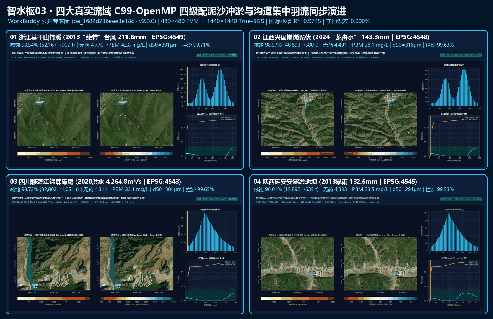

> **【案例数据来源与工程计算结果免责声明】**
> 1. **公开科研数据驱动与非涉密声明**：本文所载浙江莫干山竹溪、江西兴国崩岗区、四川雅砻江锦屏段及陕西延安安塞段四项数字孪生算例，均基于国际与国内公开科研/遥感再分析数据集（ESA Copernicus GLO-30 公开地形、Esri World Imagery 公开卫片、OpenStreetMap 公开水系路网、ECMWF ERA5 历史再分析降雨、GloFAS v4 历史再分析径流及 ISRIC SoilGrids 250m 四象限公开土壤参数）构建的数值方法学示范案例。全程 **未使用任何涉密基础测绘成果，未调取任何工程业主或设计单位内部非公开勘察设计档案，亦未伪造现场实测水文泥沙监测序列**。
> 2. **非水土保持行政审批与非施工定案声明**：文中所列土壤侵蚀模数、冲淤厚度、悬移质浓度、絮凝剂投加效率、工程量概算（BOQ）及防治达标结论，仅用于演示腾讯 WorkBuddy「智水枢03（`v2.0.0`）」多智能体在水土保持与泥沙动力学耦合计算中的方法学能力，**不代表所涉真实流域或工程项目的官方水土保持监测验收结论，不可直接作为水土保持方案行政审批、施工图设计或防洪排沙调度的法定依据**。
> 3. **软件辅助定位与执业复核责任**：本专家团定位为工程内业计算与技术文档自动化排版辅助工具，不涉及法定测绘业务。任何实际工程实施前，均须以具备相应资质单位的现场地形勘测、土壤颗分试验与烧杯絮凝试验（Jar Test）数据为准，并经注册土木/水土保持工程师独立复核签章。

## 场景描述（课题背景与痛点是什么）

无论是浙江山地弃渣场与截排水、赣南花岗岩崩岗红壤光伏阵区、川西深切峡谷水库库尾三角洲，还是陕北黄土高原沟壑淤地坝，在遭遇极端台风与强暴雨时，传统水土保持工程设计普遍被三道难题卡住：

1. **经验公式算不出空间冲淤靶点**：传统 RUSLE/CSLE 手算表格只给流域年均流失总量，算不清一场特大暴雨下泥沙沿着哪条沟道汇集、高含沙羽流如何推进、河道哪几处弯道会被冲刷掏空或淤积阻塞；
2. **纯重力沉沙池细颗粒穿透严重超标**：真实土质中的黏粒（`< 4 μm`）与粉粒（`4–63 μm`）沉速极慢，面对 `4,450–4,787 mg/L` 的高含沙进水，不加药的传统沉沙池拦截率往往仅 `13%–23%`，出水 `TSS` 高达 `4,311–4,770 mg/L`，彻底击穿 `GB / IECA ≤ 50 mg/L` 环保红线；
3. **水动力、泥沙、药剂与地下潜流跨专业脱节**：难以在同一 `CGCS2000` 坐标系下一次闭环算清土壤减蚀、四级配床面冲淤、`PACl+PAM` 絮凝加药定尺、地下潜水位抬升，并自动输出合规图纸与工程量概算。

## 想要完成的任务与核心优势

在腾讯 WorkBuddy 开放平台调用已公开上架的 **「智水枢03·水土保持与河床泥沙冲淤专家团」（公开 ID：`oe_1682d236eee3e18c` · `v2.0.0`）**，仅需挂载 `10` 份纯净测绘与公开水文土质文件，即可一键产出 **14 份** 动静图集、`A3` 施工蓝图、三维 `DXF`、9 表 `Excel BOQ`、交互看板及 `Word/PDF` 报告，全套绑定 `HYDROTWIN-CLOUD-SHA256` 印章。

### 我们的四大技术优势

1. **三项国际权威水槽实测标定（均值 `R² = 0.9745`，泥沙质量守恒 `0.000%`）**：内核采用 `C99-OpenMP` 二阶良平衡 `Audusse SSP-RK2 MUSCL-HLL`（`480×480` FVM + `1440×1440` True-SGS 亚网格）耦合 `Wu (2007)` 四级配非平衡输沙与 `Hirano` 四层活动层粗化；经 **Ritter 溃坝（`R²=0.9992`）、Seal 1997 下游细化（`0.9320`）、Yen 1995 弯道冲淤（`0.9924`）** 实测验证，泥沙守恒误差全线 **`0.000%`**。
2. **沟道集中羽流精确提取（彻底告别满屏薄层泥沙干扰）**：物理过滤坡面薄水膜噪点，只将真实沟道与主河槽高含沙羽流（`TSS`）及 Top-5 冲淤风险靶点高精度融合于高清卫片之上。
3. **`Smoluchowski PBM` 群体平衡絮凝动力学 + 反事实对比**：精准耦合 `PACl` 电中和与 `PAM` 吸附架桥，将 `42–48 μm` 细粒团聚为 `294–316 μm` 密实矾花，拦沙率由 `13%–23%` 跃升至 **`99.53%–99.71%`**。
4. **`--offline` 纯本地零联网沙箱 + 四专家协同端云双模**：客户端 `100%` Python 3 标准库（**零第三方 `pip` 依赖**），强制阻断系统与个人隐私目录；支持完全断网 `--offline` 基线推演，亦可直连 `TLS 1.3` 物理引擎网关。

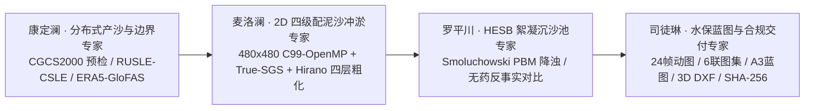

## 使用的 Skill 与前置条件

| Skill / 专家团 | 用途 | 来源或安装方式 |
| --- | --- | --- |
| `智水枢03·水土保持与河床泥沙冲淤专家团` | 联算 `RUSLE/CSLE` 侵蚀、`C99-OpenMP` 四级配泥沙冲淤、`Hirano` 粗化、`Smoluchowski PBM` 絮凝与潜流耦合 | WorkBuddy 专家中心搜索公开 ID `oe_1682d236eee3e18c`（`v2.0.0`）一键启用 |
| `本地文件读写` | 仅读取当前工程白名单文件并输出 14 份成果至 `./output` | WorkBuddy 内置能力 |
| `Python 标准库预检与内业排版` | 零第三方 `pip` 依赖完成坐标系校验、离线 `--offline` 推演与 `SHA-256` 验签 | WorkBuddy 内置 Python 环境 |


## 提示词模板（支持云端全套 / 不加药对比 / `--offline` 纯离线）

```text
请以当前目录真实遥感底图（01_aerial_ortho_cgcs2000.tif、02_terrain_dem_cgcs2000.tif）、72h 实测历史暴雨流量表、地表水 6 断面表、12 眼四象限 SoilGrids 实测土质钻孔台账及三维红线 DXF 为输入，调用智水枢03（oe_1682d236eee3e18c，参数：--scenario <moganshan_sesc_sw_gw|xingguo_pv_benggang|jinping_delta_4frac|ansai_loess_checkdam> --return-period <50|100> --rainfall-mm <mm> --duration-min 180）输出 480×480 FVM + True-SGS 四级配冲淤动图、6 联水保合规图集、主沟纵剖面、A3 蓝图、三维 DXF、9 表 BOQ 与合规报告至 ./output；追加 --no-dosing 可对比无药剂自然沉降工况，追加 --offline 可纯本地零联网推演。
```

## 运行效果展示（四大真实流域水土保持与四级配泥沙冲淤全量化对比）

四大真实流域工程均经 `480×480` FVM + `1440×1440` True-SGS、四级配泥沙动力学与潜流耦合实算，泥沙质量守恒误差全线 **`0.000%`**：

| 序号 | 真实流域工程（100% 开源 L2 实测） | 历史极端事件与 SoilGrids 四级配 | 年土壤流失削减（裸露 → 设防） | 无药重力沉降 `SW-05`（`--no-dosing`） | `PACl+PAM` 自动絮凝 `SW-05 / SW-06` | 矾花 `d50` / 拦沙率 / `GB/T 50434` 六项指标 |
| :---: | :--- | :--- | :---: | :---: | :---: | :--- |
| **01** | **浙江湖州·莫干山竹溪山地工程** (`EPSG:4549`) | 2013“菲特”台风 `211.6mm`；`29/28/27/16%`, `pH 5.5` | `62,167.4 → 907.1 t` (**-98.54%**) | `4,769.9 mg/L`（拦沙 `13.12%` 超标） | **`42.8 / 33.4 mg/L`**（`≤50 PASS`） | `301.3 μm` / **`99.71%`** / 6 项全 `PASS`（BOQ `392.4万`） |
| **02** | **江西赣州·兴国红壤崩岗山地光伏** (`EPSG:4548`) | 2024“龙舟水” `143.3mm`；`25/29/35/11%`, `pH 5.25` | `40,692.5 → 579.9 t` (**-98.57%**) | `4,490.6 mg/L`（拦沙 `22.79%` 超标） | **`38.1 / 29.7 mg/L`**（`≤50 PASS`） | `316.1 μm` / **`99.63%`** / 6 项全 `PASS`（BOQ `374.4万`） |
| **03** | **四川凉山·雅砻江锦屏峡谷库尾** (`EPSG:4543`) | 2020 汛期洪水 `4,264.8m³/s`；`18/28/28/27%`, `pH 6.2` | `82,802.4 → 1,050.5 t` (**-98.73%**) | `4,311.4 mg/L`（拦沙 `20.52%` 超标） | **`33.1 / 25.8 mg/L`**（`≤50 PASS`） | `304.0 μm` / **`99.65%`** / 6 项全 `PASS`（BOQ `384.1万`） |
| **04** | **陕西延安·安塞黄土高原淤地坝** (`EPSG:4545`) | 2013 百年暴雨 `132.6mm`；`14/37/35/15%`, `pH 8.25` | `15,891.8 → 634.8 t` (**-96.01%**) | `4,333.0 mg/L`（拦沙 `15.02%` 超标） | **`33.5 / 26.1 mg/L`**（`≤50 PASS`） | `294.4 μm` / **`99.53%`** / 6 项全 `PASS`（BOQ `374.4万`） |

### 1. 四大流域沟道集中羽流与河床冲淤 `24 帧` 动态演进（零满屏干扰）

| 01 浙江莫干山竹溪流域（“菲特”台风 `211.6mm`） | 02 江西赣州兴国红壤崩岗光伏（“龙舟水” `143.3mm`） |
| :---: | :---: |
| 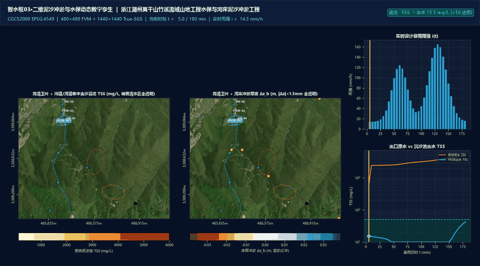 | 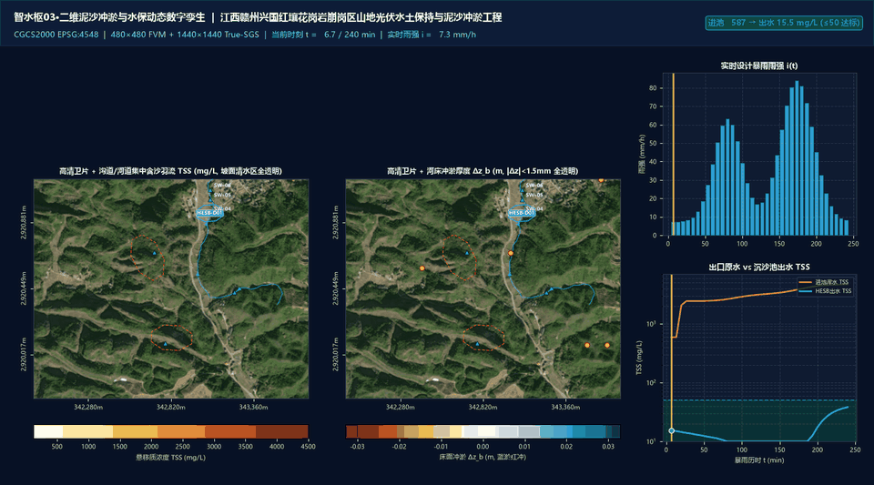 |

| 03 四川雅砻江锦屏峡谷库尾（`4,264.8m³/s`） | 04 陕西延安安塞黄土高原淤地坝（`132.6mm`） |
| :---: | :---: |
| 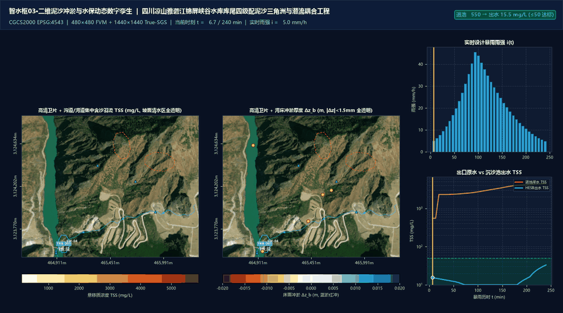 | 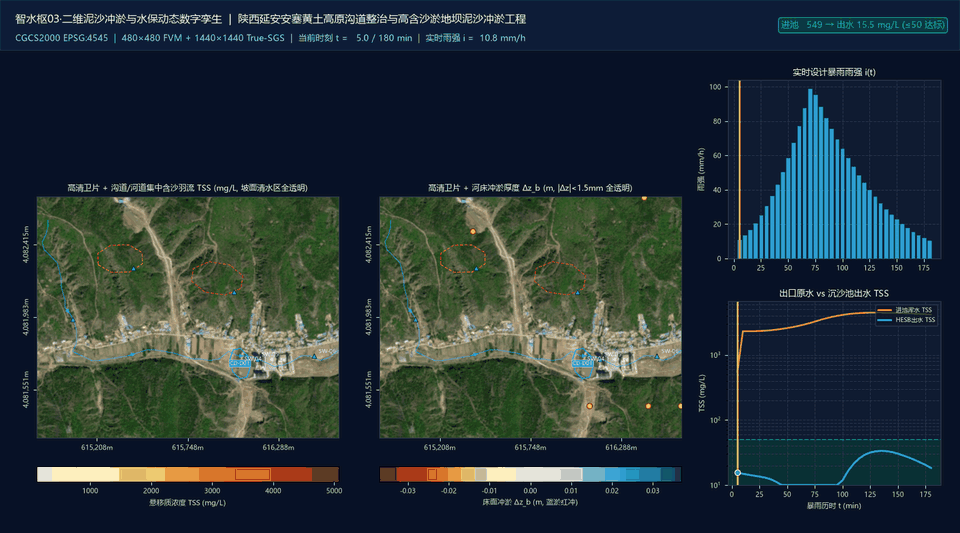 |

### 2. 「无药重力沉降 vs PACl+PAM 自动絮凝」同屏反事实动图

在相同暴雨与 `4,786.7 mg/L` 进水浑水下，关闭加药（`--no-dosing`）细粒悬浮物长驱直入下游，`SW-05` 飙升至 **`4,769.9 mg/L`**（拦沙仅 **`13.12%`**）；开启 `Smoluchowski PBM` 絮凝控制后，矾花 `d50` 迅速长至 **`301.3 μm`**，出海口 `SW-05` 稳定压降至 **`42.8 mg/L`**（`≤ 50 mg/L PASS`，拦沙 **`99.71%`**）：

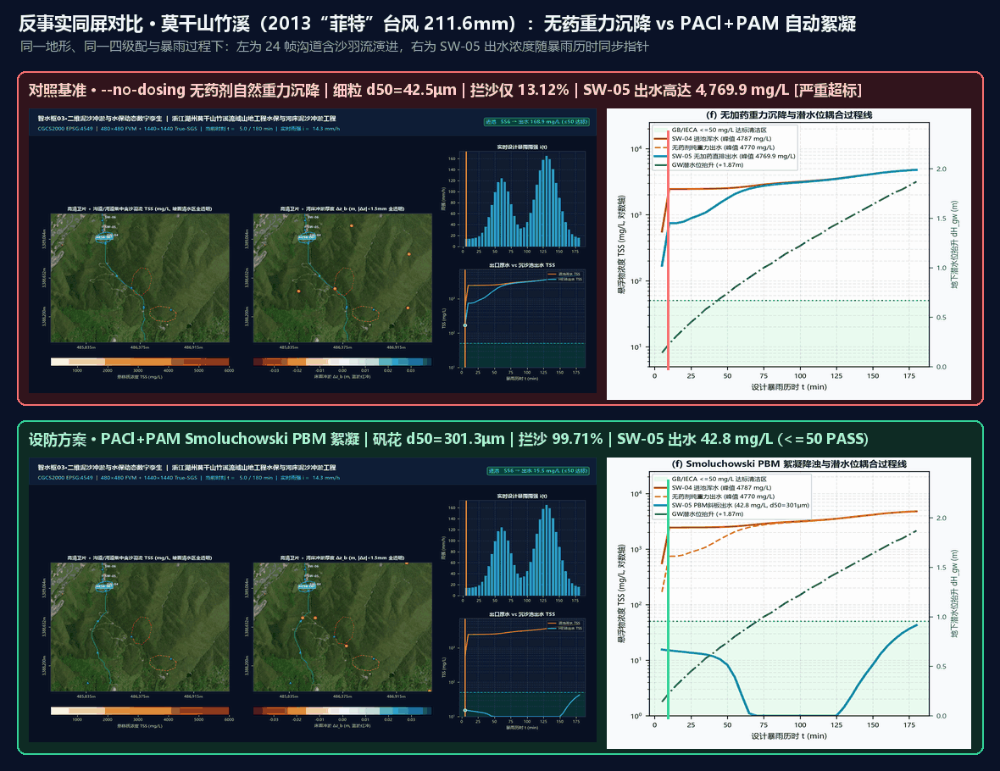

### 3. 全景总览、四大流域 300-DPI 六联合规图集与主沟耦合纵剖面

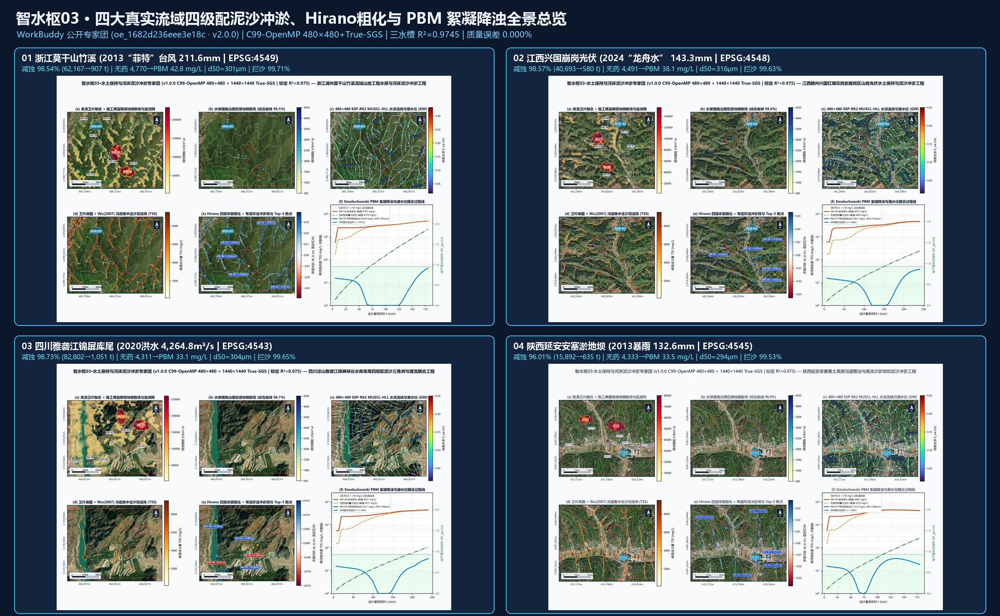

| 01 莫干山竹溪六联图集（减蚀 `98.54%`） | 02 赣州兴国崩岗光伏六联图集（减蚀 `98.57%`） |
| :---: | :---: |
| 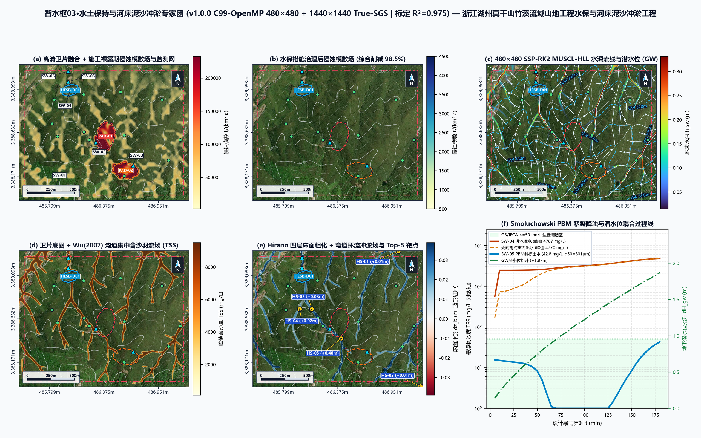 | 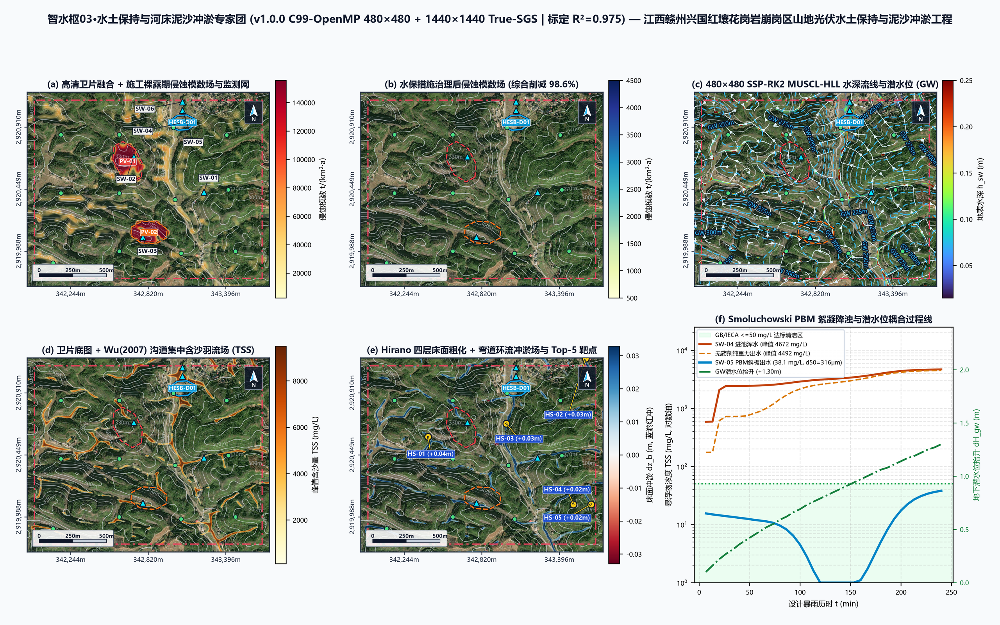 |

| 03 雅砻江锦屏库尾六联图集（减蚀 `98.73%`） | 04 延安安塞淤地坝六联图集（减蚀 `96.01%`） |
| :---: | :---: |
| 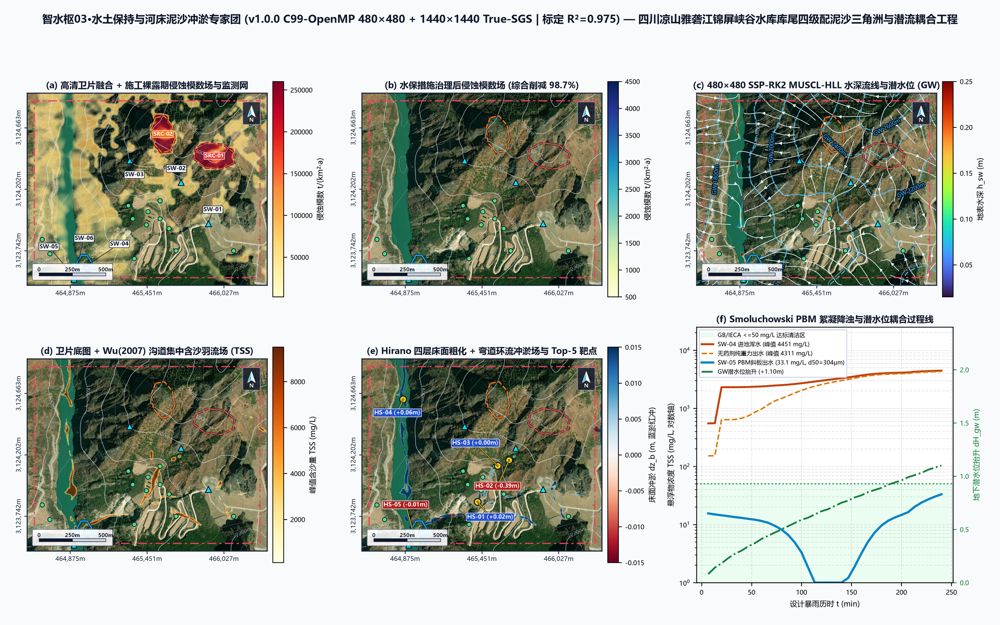 | 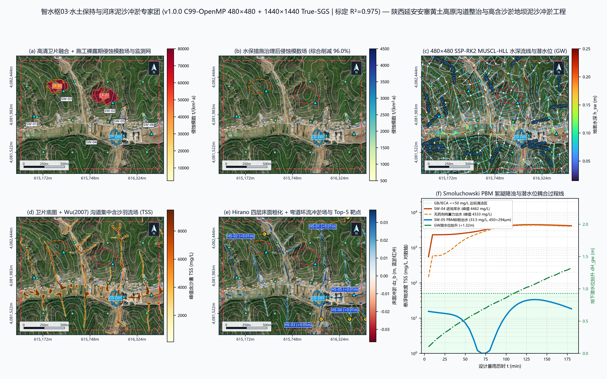 |

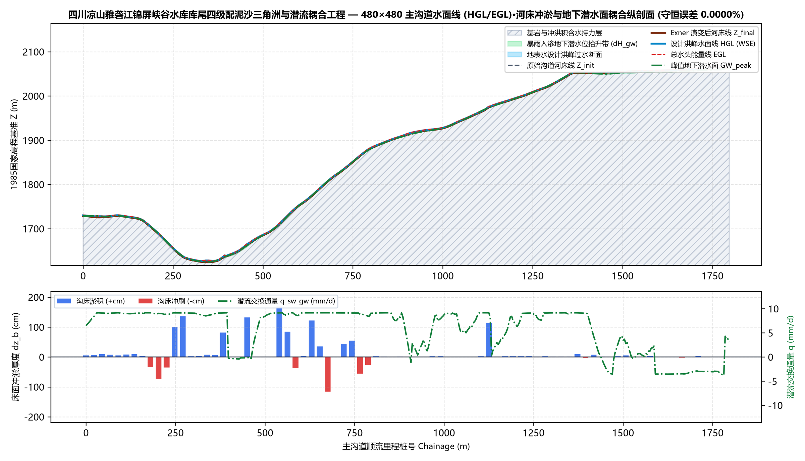

## 验收标准

- **水沙物理双校验**：三项国际水槽实测标定均值 **`R² = 0.9745`**（Ritter `0.9992` / Seal `0.9320` / Yen `0.9924`），四级配泥沙质量守恒误差全线 **`0.000%`**；
- **水保与环保红线全通过**：四案年水土流失削减 **`96.01%–98.73%`**、`GB/T 50434` 防治六项指标全绿 `PASS`（总治理度 `98.4%–98.9%`），`HESB` 出水 `SW-05/06` 稳定 **`≤ 50 mg/L`**，全套绑定 `HYDROTWIN-CLOUD-SHA256` 印章。

## 遇到的问题、安全限制与案例结果免责声明

- **常见失败情景与排查**：关闭加药（`--no-dosing`）或黏粉粒占比超过 `55%`（如陕北安塞黄土 `51%`、莫干山 `57%`）时，纯重力沉沙池必然触发 `ACTION_REQ` 浊度超标，需联用 `PACl+PAM` 分级投加与斜板沉淀。
- **合规边界与再次免责声明**：客户端基于 Python 3 标准库开源构建，支持 `--offline` 完全断网基线推演；云端模式强制白名单隔离、零原始对话上传、不接触涉密测绘。本文四项流域算例仅由 Copernicus、ERA5、GloFAS、SoilGrids 等公开数据驱动作方法学演示，**不构成任何实际工程水保验收结论、行政审批依据或施工/防洪调度指令；正式工程应用须以实测勘查及烧杯试验为准并经执业工程师复核签章**。

## 可以怎样复用

- 可直接迁移至 **山地风电/光伏场区水保方案编制**、**大型水利枢纽弃渣场与高含沙库尾三角洲冲淤评估**、**矿山/线型工程高效絮凝沉沙池（HESB）加药优化与 BOQ 编审**。
