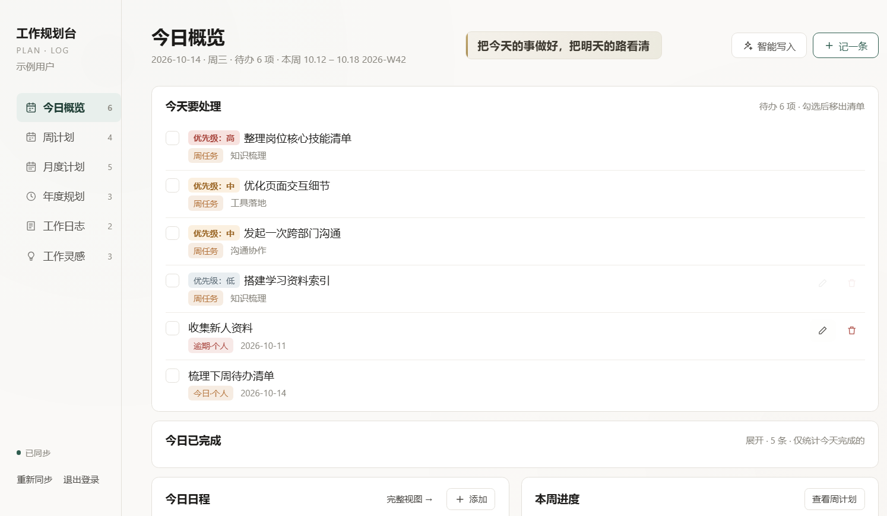
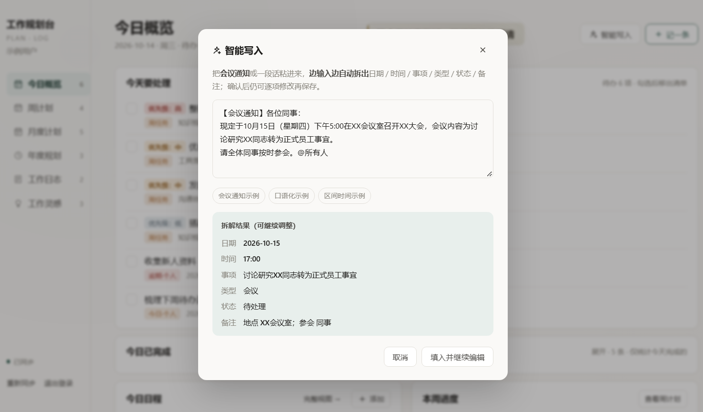
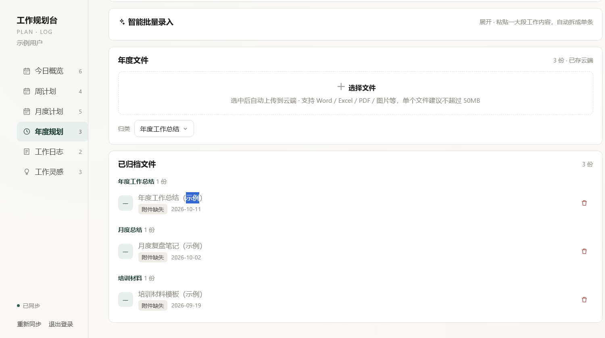

# 用 WorkBuddy 搭建个人工作规划台：把日周月年四级节奏收进一个页面

> 提交前，请先搜索社区案例集和蓝皮书，确认场景或任务没有重复。
> 本Case 使用了自建的 `workplan-console` 技能包 + 资料库六张数据表 + 自动化校验脚本，
> 与现有案例（年度报告、东莞城市指南、茶店销售分析等）在目标和交付方式上均不同。

## 场景描述

我是一个需要同时推进多条工作线的中层管理者，日常被三类问题反复消耗：

**第一类：记录散落，临时查不到。**
会议通知在群里，日计划在便签里，完成情况在脑子里。某天突然要回忆"上周三到底开了什么会"，只能翻聊天记录翻半小时。

**第二类：往日任务堆积成今日待办。**
很多管理工具里，完成的任务只是打个勾，还挂在清单上。第二天打开一看，本周已完成的三五条赫然在列，真正拖到今天的反而被淹没。列表越长，越不知道先做哪个。

**第三类：年度目标停在纸面。**
年初定的目标写得漂亮，但没拆到"这周具体做哪三件事"。到季度末才发现无从下手。

我先后试过日历、待办清单、表格，都没能解决。它们的共同问题是：**只有"任务"这一层，没有"今天 / 本周 / 本月 / 今年"这四个时间尺度之间的联动**。

## 想要完成的任务

**输入**：一段时间内的工作记录片段（会议通知、零散事项、目标设想）。

**目标**：搭建一个页面，同时回答四个问题：
- 今天还有哪些没做完的？
- 本周推进到哪一步了？
- 本月计划完成情况如何？
- 今年的目标拆到了什么颗粒度？

**预期交付物**：
1. 一个单页 HTML 工作台（零外链、可离线打开）
2. 背后的资料库数据表（6 张：日志 / 周计划 / 月计划 / 年度目标 / 灵感 / 附件）
3. 一个可复用的技能包，别人装上后能一键生成自己的工作台
4. 一套自动化校验脚本，改代码时能挡住回归

## 使用的 Skill

| Skill | 用途 | 来源或安装方式 |
| --- | --- | --- |
| library | 建6 张资料库数据表、双向同步数据、发布页面为公开链接 | WorkBuddy 内置 |
| workplan-console | 提供成品页面模板、建表脚本、踩坑清单；二次开发时的唯一依据 | 自建，附于本 Case |

`workplan-console` 包含：

| 文件 | 作用 |
| --- | --- |
| `assets/workplan.template.html` | 完整页面模板（表ID为占位符，已脱敏） |
| `scripts/create_databases.py` | 建 6 张表，支持 `--emit-schemas` 零依赖降级 |
| `scripts/check_consistency.py` | 自动比对建表脚本与模板字段，防止二者漂移 |
| `references/pitfalls.md` | 13 条踩坑清单（多数会导致整页空白） |
| `references/database-schema.md` | 表结构与数据写入契约 |

## 前置条件

- **WorkBuddy 版本**：5.8.2（需支持资料库数据表与页面发布）
- **操作系统**：Windows 11 / macOS / Linux 均可
- **所需账号或权限**：WorkBuddy 账号；发布公开链接需注意链接任何人可访问
- **所需输入文件**：无需额外文件，模板自带完整页面结构

## 在 WorkBuddy 中的操作

1. **建数据表**：运行 `create_databases.py` 一次性创建 6 张表，拿到各表 ID
2. **替换占位符**：把模板里的 6 个 `&#123;&#123;DB_*&#125;&#125;` 占位符替换成真实表 ID（必须全部替换，表 ID 在文件中出现 70 处）
3. **字段一致性校验**：运行 `check_consistency.py`，确认建表脚本与模板 `FIELD_TYPE` 完全一致
4. **发布页面**：`import_html.py --databases` 建页并绑定数据表，再 `publish_page.py` 发布为公开链接
5. **灌入测试数据**：验证各字段类型是否正确写入
6. **四关校验**：语法、业务断言、页面质量、数据库 SDK 规范，全部通过才发版
7. **迭代**：根据实际使用反馈修改页面，每轮改动都重跑校验

## 提示词或任务指令

### 建立工作台

```text
请帮我搭建一个个人工作规划台，要求：
1. 六个页签：今日概览、周计划、月度计划、年度规划、工作日志、工作灵感
2. 数据存在资料库数据表里，页面与数据表双向同步
3. 年度/月度/周计划都能拖动滑块调进度（0/50/100对应未开始/进行中/已完成）
4. 工作日志支持粘贴会议通知原文，自动拆解成日期、时间、事项、类型、状态、备注
5. 发布成公开链接，手机和电脑都能打开

请先告诉我需要建哪些数据表、每张表有哪些字段，然后再开始搭建。
```

### 解决"往日任务堆进今日待办"

```text
我需要一个"完成日期"字段，用来记录工作是什么时候完成的。
"今日已完成"只统计完成日期等于今天的记录，
往日完成的沉到底部折叠区，不要占用今日待办的位置。

请在周计划、月度计划、年度目标、工作日志四张表都加上这个字段，
并且确保这几个入口写入时都维护它：
1. 勾选完成 / 取消勾选
2. 进度拖到 100 / 拖回非 100
3. 新建和编辑弹窗保存
```

### 二次开发时的关键约束

```text
这个页面有 24 万字符，禁止通读。请用 Grep 定位函数名或类名，
只读周边 20-60 行。改完必须跑四关校验，任一 FAIL 别发。

特别注意：
1. CSS只能写在 <style> 里，写进 JS 会导致整页空白
2. 用 getBoundingClientRect 定位的元素必须配 position:fixed
3. 统一控件高度用固定 height + box-sizing，不要用 min-height + padding
4. 统一视觉风格要连 DOM 结构一起改，只改 CSS 不够
```

## 在 WorkBuddy 中的效果

产出五个可复查的交付物：

### 1. 可用的工作台页面

六个页签联动，数据存资料库、跨设备同步。核心能力：

- **三级进度联动**：年 / 月 / 周都可拖动调进度，0/50/100 对应未开始/进行中/已完成，红黄蓝三色
- **日志智能批量录入**：粘贴「10月15日（星期四）下午5:00在XX会议室召开支部党员大会，会议内容为讨论研究某同志转为正式党员事宜」，自动拆成日期/时间/事项/类型/状态/备注，逐条确认后保存
- **完成日期机制**：记录"何时完成"，今日已完成只统计今天真正完成的
- **五周记录密度热力图**：颜色深浅代表当天记录密度，悬停显示当天几点开什么会
- **待完成历史记录**：会议预约到期未完成自动进区提醒

示例页（内含虚构演示数据）：https://workbuddy.link/p/SLPZoec0ZryaTf2oDOE4fV

**今日概览页** —— 六条待办带优先级标签，底部「今日已完成 · 展开 5 条 · 仅统计今天完成的」正是完成日期机制的直观体现：

```md

```

**智能写入弹窗** —— 粘贴一段会议通知原文，下方实时显示拆解结果（日期/时间/事项/类型/状态/备注），确认后仍可逐项修改：

```md

```

**年度文件与智能批量录入** —— 上传区 + 已归档文件列表，右侧的「智能批量录入」折叠框与页面其他折叠框保持同款风格：

```md

```

### 2. 自动化校验脚本

页面改动有回归风险——改CSS 时一个花括号不配对会吞掉后面所有样式，而语法检查是通过的。为此建了四关校验：

| 关卡 | 检查什么 |
| --- | --- |
| 冒烟测试 | JS 语法、CSS 是否混入 JS、运行时是否抛错 |
| 业务断言 | 160 条断言，锁死表结构、交互口径、样式规格 |
| 页面质量 lint | 页面规范 |
| 数据库 SDK lint | SDK 调用规范 |

```text
bash check.sh
=== 1/4 冒烟测试 ===
[1] 语法检查: 通过
[2] CSS 混入 JS: 通过
[3] 运行时: 通过
=== 2/4 业务断言 ===
SANDBOX_OK assertions=160
=== 3/4 页面质量 lint ===
MINDX_PAGE_QUALITY_OK
=== 4/4 数据库 SDK lint ===
MINDX_DBSDK_LINT_OK
```

### 3. 可复用技能包

把整个搭建流程打包成 `workplan-console`，同事装上后说一句「帮我搭个工作规划台」就能生成自己的工作台，各人数据互不可见。

### 4. 迭代记录

从第一版到定稿共 50 个版本，每一轮都由真实使用反馈驱动。典型迭代：

| 反馈 | 改动 |
| --- | --- |
| 「记一条」按钮太重 | 页头主按钮去实心底色，改白底描边 |
| 「浮层离日期太远了」 | 定位用了视口坐标却配 absolute，改为 fixed |
| 「每条要用序号符号」「太长要换行并对齐」 | CSS `::before` 加序号，悬挂缩进实现续行对齐 |
| 「这个框的风格跟第一个框一致，hover 不要变色」 | 统一折叠框样式，并连 DOM 结构一起改（删除多余行尾按钮） |
| 「昨天完成的工作被归到今日已完成」 | 新增完成日期字段，四个写入点统一口径 |

## 验收标准

- 页面可正常打开，六个页签均可切换，无 JS 报错（浏览器控制台为空）
- 拖动任一级进度滑块，状态标签与颜色同步变化，刷新后状态保持
- 粘贴一段会议通知原文，能正确拆出日期、时间、事项、类型
- 勾选完成时写入当天完成日期；取消勾选时清空
- 昨日完成的任务不出现在"今日已完成"中
- 数据存资料库，换设备打开数据仍在
- `bash check.sh` 四关全绿，业务断言 160 条全部通过
- `check_consistency.py` 报告 6 张表字段全部一致
- **人工复查**：模板与技能包中不含真实姓名、密码哈希、真实数据表 ID、业务关键词

## 遇到的问题

**1. 发布后线上还是旧内容**
`commit_page_transaction` 成功、baseVersion 也生成了，但公开链接内容不变——漏了 `publish_page.py` 这一步。
自检时还要注意：`create_page_transaction` 返回的 url 指向**基线快照**，拿它校验会误判"没更新"，必须用 `list_page_publish_artifacts` 返回的 url。

**2. 浮层飘到页面左上角**
定位用了 `getBoundingClientRect()`（视口坐标），CSS 却写 `position:absolute`（文档坐标）。页面一滚动就偏出去。
规律：**凡是用 getBoundingClientRect 定位的元素，CSS 必须配 fixed。**

**3. 灌数据时日期列被静默丢弃**
接口返回 200、记录也建好了，但所有值是空的。根因是日期字段没显式声明类型，被当成文本发出，而列本身是 date 类型——**接口不报错，字段直接丢**。
数据写入必须按 `&#123;"字段名": &#123;"类型键": 值&#125;&#125;` 格式，且每张表的所有非文本字段都要显式声明。

**4. 建表脚本与模板字段漂移**
脚本里附件表写的是"标题/日期/备注"，模板实际要"标题/分类/年度/备注/上传日期"。按脚本建完表，附件区直接报错。
为此写了 `check_consistency.py`，从模板里抽出 `FIELD_TYPE` 逐项比对，**这类不一致不允许再靠人眼发现**。

**5. 误判"上线 bug"**
用 grep 读文件时，工具回显把 `SHA-256` 显示成了 `SHA-256`，据此误判成算法名无效的严重 bug，差点改坏文件。
改用字节级校验（`bytes([50,53,54]) in b`）才确认文件本身是对的。
规律：**校验文件内容不能只信命令回显**。

## 安全与限制

- **登录闸门只是轻量拦截**：页面用 SHA-256 比对用户名密码，但哈希明文写在源码里，有心人可绕过。只挡随手点开的人，**不是数据加密**。真正的访问控制必须靠资料库的成员权限设置。
- **公开链接任何人可访问**：发布后的链接拿到就能打开。需限制的话要在资料库界面把可见范围改成"仅指定成员可见"。
- **分享技能包必须脱敏**：技能包分发了页面源码，因此必须移除姓名、登录哈希、真实数据表 ID，以及**示例文案和注释里的业务背景词**——后者最隐蔽，注释里的算法举例会完整还原业务画像。
- **改文件脚本要保留换行符**：用 Python 重写文件时必须 `newline=''`，否则 CRLF 被压成 LF，文件体积和校验和全变。实测243KB 文件变成 238KB。
- 保持基线快照：每轮确认的版本存一份快照，改崩了直接恢复。

## 可以怎样复用

**最快路径**：装上 `workplan-console` 技能包，对AI 说「帮我搭一个工作规划台」，会自动建 6 张表、替换占位符、走完发布流程。

**手工搭建**：本案例的 `assets/` 与技能包都提供了完整模板和脚本，按上文四步操作即可。

**迁移到自己场景**：

| 你的情况 | 怎么改 |
| --- | --- |
| 岗位不同（比如销售、研发） | 改 `FIELD_TYPE` 的字段名和弹窗表单，通常只改这两处 |
| 只需要"今天"和"本周" | 删掉月度和年��页签，同时从 `data-bind` 里移除对应表 |
| 想加自定义区块 | 参照现有 `planRow` / `yearCard` 的写法，注意用 `.box` + `.box-h` 保持风格统一 |
| 需要给团队共用 | 注意数据隔离：每人一套表 + 一个页面，否则会互相覆盖 |

**改造时优先看** `references/pitfalls.md`，里面每一条都是实际事故，其中三条会导致整页空白。

**最重要的一条经验**：

> 统一视觉风格要连 DOM 结构一起改，只改 CSS 不够。
> 例：两个折叠框「一个用独立行尾按钮 vs 一个把状态写进说明文字」，
> 只改 CSS 看起来仍不像一家人——结构差异必须一起改。